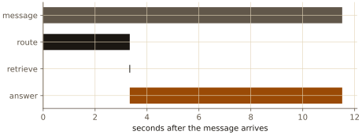
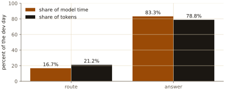

# Trace a request, then ask where its time went

By the end of this chapter you can build one message's trace by hand, print it as a tree, and say where its time and tokens went. You can then do the same sums over a day of messages and say which step takes the most.

Ambrewick is a personal assistant app's back end, written for this book. A user sends a message, and the assistant answers it from its knowledge base, from a tool, or with a fixed reply. Its log keeps one line for each message and one for each reply, and nothing between them. On the dev day, the twenty messages of 2026-12-07 that this chapter replays, the slowest message was message {{out:sum-dev-day-steps:slowest message}}. It took {{out:sum-dev-day-steps:slowest message time}} from arrival to reply. Message 809 is the first one this chapter traces. It reads "{{out:replay-one-message:message text}}", and its time from arrival to reply is {{out:figure-dev-day-waterfall:message, time from arrival to reply}}. The log cannot say how that time divided between choosing a route, searching the knowledge base and writing the answer. A trace records that division, one timed step at a time.

## One message, one trace {#one-message-one-trace}

A trace is kept per message because that is the unit a question about a user's experience is asked about. Someone who asks why message 809 was slow needs its steps together, and someone who asks where the day's time went needs the traces of all twenty messages side by side. A log line per event cannot be grouped that way without a key, and the [trace ID](#spans-by-hand) is that key. Every span of one message carries it, so the two questions are one query each, not a search through text.

A trace is the record of one user message's work: every span made for it, sharing one trace ID. Their parent links join them into a tree, and a span whose parent is missing still belongs to the trace. A span is a named, timed operation with attributes and a parent, except the root, which has none. The root covers the whole message, and each step the assistant takes is a span beneath it, with its own start and end.

The Agent Harnesses book also keeps a record of each step, and it calls that record a trace. There a trace is a file with one JSON object per line, the transcript of one run of an agent, as [One line per event](https://rollingedition.com/agent-harnesses/s/one-line-per-event) describes. Here a trace is OpenTelemetry's spans, one trace per message, and its tree is made of parent links. The two books agree on what a trace is for, and they differ in form.

Ambrewick handles a message in up to five steps. The route step makes one model call that picks one of seven routes. Three of the routes, `messages`, `devices` and `media`, search the knowledge base before answering, and that search is the retrieve step. The answer step makes a model call that writes the reply. An answer call may ask for a tool instead of replying; the tool step runs it, and a further answer call writes the reply. A message routed to `fallback` gets a fixed reply with no model call. Message 809 runs three of the five steps: route, retrieve and answer. Its trace has four spans, a root named `message` and one child for each step.

The messages come from Amazon's MASSIVE dataset, version 1.1. Its English locale, en-US, is the source of this book's traffic. A row of the dataset is an utterance, and once an utterance is in the traffic it is a message. MASSIVE's data is licensed CC BY 4.0, and the dataset is described in [FitzGerald and colleagues, 2023](https://aclanthology.org/2023.acl-long.235/), published in the Proceedings of ACL 2023. MASSIVE has 52 locale files, one of them the English seed. That seed is SLURP, a spoken-language dataset whose English text crowd workers wrote from prompts, as [Bastianelli and colleagues, 2020](https://aclanthology.org/2020.emnlp-main.588/) describe. SLURP's text is also CC BY 4.0. Crowd workers wrote these texts for the datasets, in the voice of someone talking to an assistant. They are not logs from any real assistant. Ambrewick, its tools and its knowledge base are the book's own.

**Working rule:** Make one trace for each user message, with a root that covers the message's whole time and one span for each step its work went through. A trace that covers a run of several messages, or only some of the steps, cannot answer a question about one message, and a log line that lacks the trace ID cannot be joined to the others.

## Replay and the virtual clock {#replay-and-the-virtual-clock}

Message 809's trace needs a time for each step, and here those times come from a recording, not from a clock. A replay gives each model call the reply the recording holds, together with the call's recorded time and its [token counts](#three-token-counts). Nothing waits for a model here, and nothing is measured. The [OpenTelemetry Specification, Trace API](https://raw.githubusercontent.com/open-telemetry/opentelemetry-specification/v1.52.0/specification/trace/api.md), at v1.52.0, expects a span's timestamps to reflect the elapsed real time of the operation, so the book's times are the recording's, replayed, by choice. The replay advances a virtual clock by the recorded time of each call. The clock is an integer count of nanoseconds since the Unix epoch, in UTC, and it starts at the message's arrival. Once the replay has run, the clock says how long the message took. The same recording moves the clock by the same amounts on every run.

The dev day is one day of twenty messages, and it is the only day this chapter uses. Each model call on it was recorded once, on the recording machine, a 4-vCPU Intel Xeon at 2.10 GHz, which ran Qwen3-4B-Instruct-2507 in its Q4_K_M GGUF file. The examples replay that recording: each model call gets the reply the run gave, with its recorded time and token counts, and no example runs a model. A hosted model answers in other times. The method below carries over to it, and the numbers do not.

A call's token counts are not a time, so they do not move the clock. They are attributes that the recording holds for each call, and the span carries them. [Cached input tokens](#three-token-counts) are derived, not reported: the prompt tokens minus the tokens llama.cpp evaluated, from its performance counters. Chapter 6 explains the derivation.

Replaying message 809 takes two model calls, and the replay prints each one and their total:

[Example: replay-one-message](../examples/replay-one-message.py)

```
route call, time: 3,336.3 ms
route call, input tokens: 142
route call, cached input tokens: 6
route call, output tokens: 6
answer call, time: 8,184.4 ms
answer call, input tokens: 331
answer call, cached input tokens: 192
answer call, output tokens: 38
message, time in model calls: 11,520.7 ms
```

The route call takes {{out:replay-one-message:route call, time}}, and the answer call takes {{out:replay-one-message:answer call, time}}. Together they make the {{out:replay-one-message:message, time in model calls}} the message spent in model calls. The replay gives the retrieve step no time, because the recording holds none for the search. The recorded run spent {{out:sum-dev-day-steps:route to answer gap, message 809}} between the route call's end and the answer call's start, and the replay drops that gap. An assertion on the clock checks only the replay's code: the clock moves by step times alone, so it can't find a gap the recording dropped.

**Working rule:** Let the recording move the clock, and never add a step's time by hand. Put an assertion beside the clock that checks its movement against the steps, so that a step which drops its time fails its run and does not reach a reader as a short total.

## Spans by hand {#spans-by-hand}

With the replay's steps and times in hand ([Replay and the virtual clock](#replay-and-the-virtual-clock)), the SDK can make the spans. This chapter's code uses the OpenTelemetry SDK for Python at {{version:opentelemetry-sdk}}. The SDK's tracer makes the spans, and two parts it's configured with decide where they go. A span processor is called when each span starts and when it ends, and on end it hands the span to an exporter, which sends it somewhere: to memory, a file or an [OTLP](#otlp-over-http) endpoint. The code here uses `SimpleSpanProcessor`, which exports each span at the moment it ends. The batch processor, by contrast, exports later, in batches, on a timer, so code that prints before a flush may find none of the spans, and a full queue drops them ([OpenTelemetry Specification, Trace SDK](https://raw.githubusercontent.com/open-telemetry/opentelemetry-specification/v1.52.0/specification/trace/sdk.md), v1.52.0). We use the simple processor so that every span has been exported by the time it's printed. In production we recommend the batch processor, because the simple one calls the exporter on the thread that ends the span, so a slow exporter slows the request. The SDK's source for `SimpleSpanProcessor.on_end` at {{version:opentelemetry-sdk}} makes that call directly. The exporter here is an in-memory one, which keeps the spans in a list inside the process.

The SDK takes a span's start time when the span is opened. Its `start_span` call has no argument for the end time, so the end goes to a separate call. The helper in `lib/tracing.py` does both, from the times it is given:

```python
recorded = tracer.start_span(name, context=context, kind=kind, start_time=start_ns, attributes=attributes)
recorded.end(end_time=end_ns)
```

Each time is an integer count of nanoseconds, and each comes from the virtual clock, which [the replay section](#replay-and-the-virtual-clock) explains. No code here reads the machine's own clock, so the same recording gives the same spans every time it runs.

Leaving the end time to the SDK would not fail. The span would end at the machine's clock when `end()` was called, and that clock runs at a different pace on each run. The same message would then print a different duration each time, and the duration would have nothing to do with the recording. The helper avoids that by taking the end time from the caller, and it refuses an end time that falls before the start, since that would print a negative duration.

A trace ID is the number every span of one trace carries, and a span ID is the number of one span. The SDK's default generator draws both at random, so `lib/ids.py` counts them instead, 1, 2, 3, and starts again for each run. A span's parent is the span whose work it is part of; its span context, chiefly the trace ID, span ID and trace flags, is what lets other code and other processes name it. The helper takes a parent span and puts it in context, so that a child span names its parent.

The resource describes what made the telemetry and is the same on every span one tracer provider makes: `service.name`, `service.version`, `service.instance.id`. For this book the service is `ambrewick-assistant`, at the version the recording was made with, and its instance ID is a fixed string set by hand, since the SDK's default is a new random UUID on every run.

An attribute is a key and a value recorded on a span or a resource, such as `gen_ai.request.model`. The attributes in this chapter are the book's own. Every step's span carries `ambrewick.step`, which names the step it came from. The root has no `ambrewick.step`; it carries `ambrewick.route` and `ambrewick.reply.source`, which is why the tree prints `(root)` for it. The two model calls also carry `ambrewick.tokens.input`, `ambrewick.tokens.cached` and `ambrewick.tokens.output`. The spans are named by step, `route`, `retrieve` and `answer`, and the root is named `message`. They keep the SDK's default [span kind](#span-kind-follows-the-process). These are rough names on purpose; chapter 2 replaces them.

[Example: build-one-trace](../examples/build-one-trace.py)

Message 809's four spans come from those calls. Each child is made with the root as its parent, by one line:

```python
span(tracer, name, step.start_ns, step.end_ns, parent=root, attributes=attributes)
```

The script then verifies that all four spans share one trace ID, and that every child names the root as its parent. The output reports {{out:build-one-trace:spans in the trace}} spans in the trace, {{out:build-one-trace:spans under the root}} of them under the root, and the [input tokens](#three-token-counts) on the route span, {{out:build-one-trace:route span, input tokens on the span}}.

What goes wrong in production is quieter than a wrong number. A span is exported only when it ends, because the simple processor passes each span to the exporter as soon as the span finishes, as the specification's [SDK page](https://raw.githubusercontent.com/open-telemetry/opentelemetry-specification/v1.52.0/specification/trace/sdk.md) says, so a span whose work never reaches its `end()` call is never exported at all. In live code the root covers the whole message, so it ends last, and a process that crashes partway through a message loses the root and the step that was running. The trace then arrives as finished steps whose parent never arrives, and with the batch processor, the spans still in its queue are lost too. The examples end the root first only because they build the spans after the replay, which live code never does. The check that finds the one span with no parent is what catches such a trace.

**Working rule:** In a replay, end every span with an explicit end time from the replay's clock. In live code, let the SDK take both times from the machine's clock. Either way, check each trace for its root, exactly one span with no parent, because a trace without one is what a crash leaves, and it reads as a few short steps, not as a failure.

## The tree of one trace {#the-tree-of-one-trace}

The four spans that [Spans by hand](#spans-by-hand) made for message 809 form a tree by their parent links, and the script then checks how their times add up. The tree lists the root and its three steps, and the lines after it give their times and checks:

[Example: print-trace-tree](../examples/print-trace-tree.py)

```
message  step: (root)
  route  step: route
  retrieve  step: retrieve
  answer  step: answer
message span, time: 11,520.7 ms
steps, time added up: 11,520.7 ms
steps overlap in time: no
message time equals the sum of its steps: yes
```

Indentation carries the parent links, so the three steps of message 809 sit one level under the root. The [OpenTelemetry Specification](https://raw.githubusercontent.com/open-telemetry/opentelemetry-specification/v1.52.0/specification/overview.md) calls a trace a directed acyclic graph of spans, and the parent links make that graph a tree, one parent for each span. The tree gives no times, so the times come from the next lines.

A child span may end after its parent. The specification's overview draws one that does, and it sets no rule against that ([OpenTelemetry Specification, Overview: Traces, Spans, SpanContext](https://raw.githubusercontent.com/open-telemetry/opentelemetry-specification/v1.52.0/specification/overview.md), tag v1.52.0). So a parent's duration is not the sum of its children's when they overlap, and it can differ from their sum when they leave gaps. In the replay, message 809's steps neither overlap nor leave a gap: the answer starts when the route ends. The script tests that, and the output gives the message's time as {{out:print-trace-tree:message span, time}} and its steps' time as {{out:print-trace-tree:steps, time added up}}, which are the same number.

A reader is tempted to read a parent's bar as the work its children did. A bar shows only where the parent started and stopped, and a gap is work no child records. Neither case is in this replay.

{{fig:dev-day-waterfall}} draws the same trace as a waterfall. The waterfall, one bar per span on a time axis, is the view tracing tools draw, and the [specification's overview](https://raw.githubusercontent.com/open-telemetry/opentelemetry-specification/v1.52.0/specification/overview.md) sketches it; the specification doesn't define it as a format, and this figure is the book's own drawing of it. It has one bar for each span, from the span's start to its end, in seconds after the message arrives. On top is the whole message's bar, then the route's bar from arrival, the retrieve step as a tick where the route ends, and the longer answer bar from there to the message's end.



[Example: figure-dev-day-waterfall](../examples/figure-dev-day-waterfall.py)

The answer span starts {{out:figure-dev-day-waterfall:answer span starts, after arrival}} after arrival, which is when the route ends. The figure's order is the order the steps ran, and its lengths are the times the clock recorded.

**Working rule:** Print a trace as a tree of parent links, and check that its children neither overlap nor leave gaps before you add their times. When they do, report the parent's time and the children's separately.

## Where the time went in twenty messages {#where-the-time-went-in-twenty-messages}

Message 809 is one trace, and the dev day is twenty of them. [One message, one trace](#one-message-one-trace) keeps each message's steps together, so the day's steps can be added up. A fallback reply is the fixed text Ambrewick sends when the router chooses `fallback`; no model writes it, and its span says so. On the dev day, {{out:sum-dev-day-steps:messages answered by the fallback reply}} messages got one. A fallback reply is the right answer only for a message that no tool or article can resolve.

[Example: sum-dev-day-steps](../examples/sum-dev-day-steps.py)

The script replays all twenty messages, one after another, and adds up each model step over the day. The day's tool calls went to the in-process tools, the calendar, alarm and list tools, whose durations are modelled from a table in the book's configuration, not recorded, so the shares leave them out and count them only as calls. Retrieve takes no recorded time either. The script also counts the messages whose steps overlap in time, and the count is {{out:sum-dev-day-steps:messages whose steps overlap in time}}. So the day's sums are sums of step times, and they are not splits of each message's root time.

The answer step holds most of the day's model time, {{out:sum-dev-day-steps:answer, share of model time}}, while the route step holds {{out:sum-dev-day-steps:route, share of tokens (input plus output)}} of the tokens against {{out:sum-dev-day-steps:route, share of model time}} of the time. Answer calls outnumber the messages a model answered, because each message that called a tool needed a further answer call after the tool returned, so the answer step ran {{out:sum-dev-day-steps:answer calls}} times. The shares are over the day's model time and its tokens, input plus output, and the output prints both totals.

{{fig:dev-day-step-shares}} draws the two shares for each model step. Time and tokens do not share a shape, as the figure shows.



[Example: figure-dev-day-step-shares](../examples/figure-dev-day-step-shares.py)

A step's share of time says where the day's waiting went, and its share of tokens says where the day's input and output came from. The two are different questions, and this chapter answers both; which step costs the most money is chapter 6's question, and it needs the prices as well as the tokens.

**Working rule:** Sum each step's recorded time and tokens over the messages, and print each share beside its denominator. Name any step whose time is not recorded and leave it out of the shares, so that a reader can see which part of the day the sums do not cover.

## What this version does not do yet {#whats-rough}

This version is a rough one, and each part of it has a later chapter that makes it solid. In order:

- **The names.** The spans are named by the book's own steps. Chapter 2 names each span by the standard's names, sets its kind, and checks it with a validator, which every span here fails.
- **The model calls.** The spans are made by hand. Chapter 3 shows what the official instrumentation of the `openai` client library emits for the same kind of call.
- **The second process.** The trace is one process's record. Chapter 4 joins the spans of the contacts team's server, which runs as a separate process, to this trace.
- **The storage.** The spans live in memory and disappear when the process ends. Chapter 5 sends them to a [backend](#otlp-over-http) that stores them.
- **[The tail](#tail-percentiles-with-intervals).** Twenty messages cannot give a tail [percentile](#tail-percentiles-with-intervals) with any confidence. Chapter 7 gives percentiles with their counts and an [interval](#tail-percentiles-with-intervals).
- **The sampling.** Every trace is kept. Chapter 11 decides which traces to keep, and why.
- **The prompts.** The spans hold no prompt text, on purpose. Chapter 3 names the switch that would record it, and chapter 12 covers what that switch leaks.
- **The wrong routes.** {{out:sum-dev-day-steps:messages answered by the fallback reply}} dev-day messages got the fallback reply, and this chapter does not check whether each route was right. Chapter 8 does.

## The decisions this chapter made {#trace-a-request-decisions}

These decisions shape the rest of the book:

- The spans are named by step for now. From chapter 2 on, the book uses the standard's names.
- Each duration is a recorded value and never a live measurement, so every printed time can be run again and matched.
- The spans are exported at the moment they end, by a synchronous processor, so that every span has been exported by the time it is printed.
- A share is printed with its denominator, and a step whose time is not recorded is left out of the shares rather than estimated.
- Each trace is one message's, and the sums over the day add up the messages' steps as the recording holds them, with no other measure built from the spans.

**Working rule:** Answer a question about one message from that message's trace alone. Every span of the message shares the trace ID, and the root covers its whole time, so the trace holds that message's steps and no other message's. A span or log line without the ID cannot be placed in the answer, so leave it out and say so, rather than guess which message it belongs to. A guess would put one message's time into another message's total.
