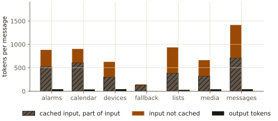

# Attribute tokens and cost to each step

By the end of this chapter you can split a day's model calls into input tokens, cached input tokens and output tokens, total them without counting any token twice, and say which step, route and user the money went to. You can also say which of those numbers depends on a price table and which does not.

Ambrewick's finance team asks two questions of the assistant's traces. The first is what one message costs, by route and by user. It sounds like a sum over the spans, and it is the question that goes wrong first: usage sits on more than one kind of span, so a sum over all of them is too high. The second is what the same messages would cost in other languages. This book's assistant serves English only, but the dataset's other locales hold the same utterances, and the same utterance takes a different number of tokens in each language. The chapter measures both on one day, baseline day 1, 2026-12-08, which holds 200 messages. Each message ran through the assistant on the baseline release, with Qwen3-4B-Instruct-2507 as the model, and each model call was recorded once and replayed on the virtual clock, as [chapter 1](#replay-and-the-virtual-clock) describes.

Tokens come first, because they are what the model did. Money comes second, because it needs a price, and the price is a choice the book makes and dates.

## Three counts for each call {#three-token-counts}

A token count is the number of tokens a model reads or writes for one call, in that model's own vocabulary. The book keeps three counts for each call. Input tokens are the whole prompt the model read, cached part included; cached input tokens are the part its cache held; output tokens are what it wrote. The GenAI conventions, at version {{out:totals-metric-against-spans:GenAI conventions version}}, define the input total the same way: `gen_ai.usage.input_tokens` includes the cached tokens. So the cached count sits inside the input count, and adding the two together counts the cached part twice.

The [prompt count and completion count](https://rollingedition.com/agent-harnesses/s/token-counts) in Agent Harnesses are close to these two, and they have no cached part. This book adds one, and it adds a price to the counts later in the chapter.

Each message makes one route call, and a message on any route but `fallback` makes one or more answer calls. The most calls one message made on this day is {{out:token-counts-per-step:most model calls in one message}}: a route call and two answer calls, when a tool's request comes before the reply. The script below sorts every call of the day by its three counts and its step.

[Example: token-counts-per-step](../examples/token-counts-per-step.py)

Most of the day's input is cached. Of {{out:token-counts-per-step:input tokens, total}} input tokens across the day's model calls, {{out:token-counts-per-step:cached input tokens, derived, total}} were cached, which is {{out:token-counts-per-step:cached share of input tokens}} of the input. The output is small by comparison, {{out:token-counts-per-step:output tokens, total}} tokens in all.

The two steps differ in size. A route request reads {{out:token-counts-per-step:route requests, input tokens per request}} input tokens on average, and an answer request reads {{out:token-counts-per-step:answer requests, input tokens per request}}, because the answer call carries more of the prompt, such as the retrieved articles and a tool's result.

Input tokens are the call's messages rendered through the chat template in the model's GGUF file and re-tokenized with the model's own tokenizer. Output tokens are the reply re-tokenized with the model's own tokenizer. Cached input is derived rather than reported, as [chapter 1](#replay-and-the-virtual-clock) says, and the cached-input section below shows the subtraction.

Divided by the messages, the day's input is {{out:token-counts-per-step:input tokens per message}} tokens per message. Per resolved message it is {{out:token-counts-per-step:input tokens per resolved message}} input and {{out:token-counts-per-step:output tokens per resolved message}} output tokens. A resolved message is one the assistant answered with a model reply, not a fallback reply. Each rate here names its denominator, because a count per request and a count per message answer different questions.

**Working rule:** Report a call's input as the whole prompt, cached part included, and report cached input beside it, never added to it. Give output on its own. Name the count's source beside any token total, because the same text takes a different number of tokens in a different vocabulary.

## Summing spans double counts {#totals-from-metrics-not-spans}

The obvious way to total a day's tokens is to add the usage on every span. That is the sum a backend's query would run first, and here it is wrong. The [conventions' note on aggregating token usage](https://raw.githubusercontent.com/open-telemetry/semantic-conventions-genai/v0.1.0/docs/gen-ai/gen-ai-token-metrics.md) says not to sum `gen_ai.usage.*` over all spans without filtering by operation name, because the same tokens can be reported on more than one type of span, such as an agent span and an inference span. Usage sits on each model call's inference span, and the assistant also sets the message's total on its agent span, as the conventions allow. [Chapter 2](#span-types-for-each-step) names both span types.

Adding the usage up three ways over the same day shows where the extra comes from.

[Example: totals-metric-against-spans](../examples/totals-metric-against-spans.py)

The assistant records each model call's tokens on its meter as the call ends, and the book reads two instruments from that meter. A metric is a measurement the SDK aggregates over many operations and exports without each one's detail; a counter only adds, and a histogram counts values into buckets with their sum and count. The input-token counter, `gen_ai.client.inference.usage.input_tokens`, gives one total for the day. The per-operation histogram records one value for each model call, its input tokens, and keeps their sum and their count.

Summed over the inference spans, the input is {{out:totals-metric-against-spans:input tokens, summed over the inference spans}} tokens. Summed over every span, it is {{out:totals-metric-against-spans:input tokens, summed over every span}}. The second figure is the first with the agent spans' copy added, so it is too high by exactly that copy. The token counter, which the assistant adds to on each model call, gives {{out:totals-metric-against-spans:input tokens, token counter total}}, the same total as the inference spans. The point to keep is that the counter and the inference spans agree, and the sum over every span does not.

The per-operation histogram's sum is {{out:totals-metric-against-spans:input tokens, per-operation histogram sum}} over {{out:totals-metric-against-spans:per-operation histogram, count of operations}} operations, the model calls, which matches the counter. The output counter gives {{out:totals-metric-against-spans:output tokens, token counter total}} output tokens.

The package this book uses writes an older token metric: one histogram, `gen_ai.client.token.usage`, that splits by `gen_ai.token.type`. [Chapter 3](#what-the-package-emits) shows its names beside the registry's, and in v0.1.0 that histogram's names are {{out:totals-metric-against-spans:package token histogram, gen_ai.client.token.usage, v0.1.0 names}}. The counters split by `gen_ai.token.modality` instead, and for each operation the modality counts add up to the total. The conventions' note says that the token counters are not affected by trace sampling, so a total read from them survives a sampler that drops spans, and a total read from spans does not. A counter filled at each call counts every call whatever a sampler keeps; a total rebuilt from sampled spans falls with the sample, and must be scaled up, with an [error](#how-a-span-records-failure), as [chapter 11](#estimating-totals-from-a-sample) shows.

**Working rule:** Take a day's token total from the counters, or sum usage over inference spans only, filtered by operation name. Usage on an agent span is that agent's total over its calls, so never add it to the calls' usage. In production we read totals from the counters, because a sampler cannot thin them.

## Cached input, derived from the counters {#cached-prompt-tokens}

The runtime does not report the reused count, so the book derives it: cached input is the prompt tokens minus the tokens the runtime evaluated. Reuse happens in two places. The runtime keeps the evaluated prefix of the last prompt, and a call whose prompt starts with the same tokens evaluates only the new suffix; the baseline also turns on a RAM cache, `PromptCache(LlamaRAMCache)` with `cache_prompt: true`, which restores the saved state of an earlier prompt with the longest shared prefix once the context's own prefix has been overwritten. The assistant's system prompt and its tool list sit at the front of every prompt, so most calls reuse them.

The pinned llama-cpp-python 0.3.37 has no cached-token field in its Python API or in the performance counters it ships. The recorder takes `n_p_eval`, the prompt tokens evaluated, as a difference between calls, because the counters accumulate. The counter `n_reused` sits in the same structure, but it counts graph reuse, not tokens, so this book does not read it as the cached count. We judge that a derived count of reused prefix tokens belongs in `gen_ai.usage.cache_read.input_tokens` and the cache-read counter, and we record a zero when nothing is reused. The registry defines that attribute as tokens served from a provider-managed cache, as the provider reports them, so the count is the book's own judgement and not a provider's report.

The same 60 messages run twice here, a seeded sample of baseline day 1: once on the baseline release, `r0`, and once on the cache-off release, `r4`. Release `r4` differs from `r0` in two ways. Its RAM cache is off, and `llm.reset()` clears the runtime's state before each call, which is the way the book's recorder gives each call a fresh state. Setting the cache to none is not enough, because the next call still reuses the prefix of the last one, as the book's probe at the pinned version found.

[Example: cached-tokens-from-replay](../examples/cached-tokens-from-replay.py)

Under the baseline the 60 messages read {{out:cached-tokens-from-replay:r0, input tokens}} input tokens, and only {{out:cached-tokens-from-replay:r0, tokens evaluated}} of them were evaluated; the rest were cached. Under the cache-off release they read the same {{out:cached-tokens-from-replay:r4, input tokens}} tokens, and all of them were evaluated. Resetting the state did not change what the model read; it changed how much of it the runtime had to evaluate, so {{out:cached-tokens-from-replay:tokens evaluated, r4 minus r0}} more tokens were evaluated.

That difference is the money. At the book's table the cache-off release [costs](#cost-per-route) {{out:cached-tokens-from-replay:cost difference, r4 minus r0, same 60 messages, book-2026-11-02}} more on those 60 messages, because cached tokens are billed at the cached rate and evaluated ones at the input rate. A release which changes the cache changes cost and leaves input tokens alone, so a comparison of input tokens would miss that change.

**Working rule:** Derive cached input at each call from the runtime's counters, never from a release's label. When a release changes the cache, we compare cost on the same messages, because the input count will not move.

## The same utterances in other languages {#the-same-requests-in-other-languages}

Tokens are counted per vocabulary, and the same text can take very different numbers of tokens in different languages. Petrov and colleagues measured the gap for several tokenizers, found differences of up to fifteen times in some language pairs, and found the gap persisted in tokenizers built for many languages, as [their NeurIPS 2023 paper](https://arxiv.org/abs/2305.15425) reports. This section measures the gap for the dataset's utterances.

Only the English messages ran through the assistant. The other five locales are the same 200 utterances in the dataset's other locale files, joined by id. No model read them and no assistant served them, so each cost is an input rate on that text. The six locales are English (en-US), German (de-DE), Japanese (ja-JP), Hindi (hi-IN), Arabic (ar-SA) and Chinese (zh-CN). The example counts all six with the tokenizer file of the model the book uses, and prices the counts at [the book's table](#the-price-table).

Each locale's count is the tokenizer file's count: the utterance's text alone, normalised to NFC and tokenized by `tokenizers` {{version:tokenizers}} with the 4B's `tokenizer.json`; no model read it, and it is not a whole prompt.

[Example: count-locales-with-the-tokenizer](../examples/count-locales-with-the-tokenizer.py)

The same 200 utterances cost {{out:count-locales-with-the-tokenizer:hi-IN tokens per utterance, as a multiple of en-US}} times as many tokens in Hindi as in English. The table gives each locale's count per utterance, and the input cost of 1,000 utterances at the book's table.

| Locale | Tokens per utterance | Input cost per 1,000 utterances |
| --- | --- | --- |
| English, en-US | {{out:count-locales-with-the-tokenizer:en-US, tokens per utterance}} | {{out:count-locales-with-the-tokenizer:en-US, input cost per 1,000 utterances, book-2026-11-02}} |
| German, de-DE | {{out:count-locales-with-the-tokenizer:de-DE, tokens per utterance}} | {{out:count-locales-with-the-tokenizer:de-DE, input cost per 1,000 utterances, book-2026-11-02}} |
| Japanese, ja-JP | {{out:count-locales-with-the-tokenizer:ja-JP, tokens per utterance}} | {{out:count-locales-with-the-tokenizer:ja-JP, input cost per 1,000 utterances, book-2026-11-02}} |
| Hindi, hi-IN | {{out:count-locales-with-the-tokenizer:hi-IN, tokens per utterance}} | {{out:count-locales-with-the-tokenizer:hi-IN, input cost per 1,000 utterances, book-2026-11-02}} |
| Arabic, ar-SA | {{out:count-locales-with-the-tokenizer:ar-SA, tokens per utterance}} | {{out:count-locales-with-the-tokenizer:ar-SA, input cost per 1,000 utterances, book-2026-11-02}} |
| Chinese, zh-CN | {{out:count-locales-with-the-tokenizer:zh-CN, tokens per utterance}} | {{out:count-locales-with-the-tokenizer:zh-CN, input cost per 1,000 utterances, book-2026-11-02}} |

The English utterances take {{out:count-locales-with-the-tokenizer:en-US, tokens per utterance}} tokens each, and the Hindi ones take {{out:count-locales-with-the-tokenizer:hi-IN, tokens per utterance}}. A budget for input tokens written in English tokens is therefore wrong for a Hindi user, and the same holds for the cost of a request. The counts are of the utterance alone, so they understate a whole prompt in every locale. What carries into a budget is the ratio between locales, and that ratio should be measured on the traffic that will run.

Some of the Hindi text is not in the normal form the tokenizer expects. {{out:count-locales-with-the-tokenizer:hi-IN utterances not in NFC, of 200}} of the 200 Hindi utterances are not in Unicode normalisation form NFC, as the [Unicode report on normalisation](https://unicode.org/reports/tr15/) defines it. The tokenizer file normalises them before counting. The GGUF tokenizer that llama.cpp uses applies no normalisation, so its count can differ from this one on those utterances, and at most {{out:count-locales-with-the-tokenizer:hi-IN utterances not in NFC, of 200}} of the 200 can differ; the GGUF count was not run. This chapter prints the file's count and no other, and it says which counter each number comes from. The chapter quotes no utterance text, because no example prints it.

**Working rule:** Count each locale with the tokenizer that serves it, after the same normalisation, and name the counter beside every figure. Budget input in the locale's own tokens, and measure the locale's ratio on your own traffic before you rely on a multiple.

## The price table {#the-price-table}

Every money figure in this chapter comes from one file, the book's price table, `examples/data/case/prices.toml`, at version `book-2026-11-02`. The price table is a dated, versioned file of rates per million tokens, read at each call's virtual timestamp. For each model it gives rates in US dollars for input, cached input and output, and a date from which each row applies. The rows were written for this book, not quoted from any provider; each row says what a hosted endpoint would charge at those rates. The ratios matter most: on the 4B row, output costs {{out:price-one-request:book's table, output rate to input rate}} times input, and cached input {{out:price-one-request:book's table, cached input rate to input rate}} of input.

Hosted providers do not all report input the same way. Anthropic's `input_tokens` excludes cached tokens, and the conventions' [Anthropic note](https://raw.githubusercontent.com/open-telemetry/semantic-conventions-genai/v0.1.0/docs/gen-ai/anthropic.md) asks instrumentation to add them in, so a reader pricing such a provider normalises its fields to the registry's input total before pricing. Cache writes are counted apart, in `gen_ai.usage.cache_write.input_tokens`. The book's runtime writes no cache, so its table has no cache-write rate.

A self-hosted model is billed by its machine, not by its tokens. The table therefore attaches a money figure to a token count so that the book can compare requests. It is not a bill for the local model, and [Small Open Models](https://rollingedition.com/small-open-models/s/count-the-bill-and-the-machine) works out a machine's bill against per-token prices.

The nearest real price is the genai-prices listing, and it differs from the book's rows in three ways: it names a provider, it has no cache price, and it carries no date. genai-prices {{version:genai-prices}} lists the repository `Qwen/Qwen3-4B-Instruct-2507` under the provider `huggingface_nscale`, with an input rate and an output rate. With no cache price, the listing bills cached input at the input rate. The rates are the snapshot the library bundles, and the library makes no network call unless its updater is started. A lookup needs both the full repository name and `provider_id="huggingface_nscale"`: without the provider it raises `LookupError`, and so does a provider it does not list, as the example asserts. The listing has no text-model row for `Qwen3-0.6B`, so the book's 0.6B row has no source. The library's 4B row has no start date, and the book's probe at the pinned version found that it prices the same request the same on 2026-11-01, 2026-11-02 and 2026-12-08. So the 2026-11-02 date in the book's table is the book's own, and the library does not supply it.

One answer request from the day, priced three ways, shows how the tables differ.

[Example: price-one-request](../examples/price-one-request.py)

The request reads {{out:price-one-request:request, input tokens, total}} input tokens, most of them cached, and writes {{out:price-one-request:request, output tokens}} output tokens. At the book's table it costs {{out:price-one-request:book's table, cached input at its own rate, book-2026-11-02}}. With the cache removed from the same request it would cost {{out:price-one-request:book's table, the same request with no cached input, book-2026-11-02}}, so the cache is what brings the bill down for this call.

The listing prices the same request at {{out:price-one-request:genai-prices listing, huggingface_nscale, the same request}}. The gap between the two is the gap between the rate rows, since the tokens are the same in both.

A cost tool needs one more guard. The book's spans record `gen_ai.provider.name` as `openai`, because the assistant's client speaks OpenAI's API to a local server, as [chapter 2](#span-types-for-each-step) explains. A cost tool that reads that value could look up OpenAI's rates for a model OpenAI does not serve, and price the local model at OpenAI's rates. The listing fails loudly on that lookup, since it raises `LookupError` for the 4B under `openai`, so the risk is a tool that falls back to a default model or a fuzzy match. The book's table is keyed by model and does not read the provider value, and the listing is queried with its provider named by hand. A query that prices spans should do the same, and should never take the provider from the span. MLflow is one such tool: it prices a span only when its catalog knows the span's model, which is why it stored no cost for the 4B in [chapter 5](#mlflow-on-sqlite), and a self-hosted model reported under a hosted model's name could be priced at that model's rates.

The table's version and dates matter once a price changes. The release comparison in [chapter 10](#paired-comparison-on-messages) reads its money from this same table version, so one version holds every money figure that is compared.

**Working rule:** Attach a price table's version and its date to every money figure. Price each call at its own timestamp, and name the provider when you use a listing. Never take a provider from a span to choose the price. We key the book's table by model, and never by the span's provider.

## Cost by route and step {#cost-per-route}

A call's cost is its tokens priced by a named, dated price table, and cost attribution assigns each call's cost to the step, route and user that caused it. [Agent Harnesses](https://rollingedition.com/agent-harnesses/s/cost-not-money) stops its cost at counts on purpose; this book adds money, tokens first. The book computes cost at query time, from each call's tokens and the table, and does not store cost on the spans. A price change then reprices the query and leaves the stored spans as they were. [Chapter 1](#where-the-time-went-in-twenty-messages) asked which step costs the most money, and this section answers it.

[Example: cost-by-route-and-user](../examples/cost-by-route-and-user.py)

The answer step costs most. Over the day's 200 messages, the answer requests cost {{out:cost-by-route-and-user:answer requests, cost, book-2026-11-02}}, which is {{out:cost-by-route-and-user:answer requests, share of cost}} of the day's cost. The route requests cost {{out:cost-by-route-and-user:route requests, cost, book-2026-11-02}}, or {{out:cost-by-route-and-user:route requests, share of cost}}. The route call is smaller, but every message makes one, so it still holds nearly a fifth of the money.

The routes differ in what a message costs. The table gives each route's messages, its tokens per message from the same day, and its cost per 1,000 messages. The denominator is the messages on each route.

| Route | Messages | Input tokens per message | Output tokens per message | Cost per 1,000 messages |
| --- | --- | --- | --- | --- |
| `alarms` | {{out:cost-by-route-and-user:route alarms, messages}} | {{out:token-counts-per-step:route alarms, input tokens per message}} | {{out:token-counts-per-step:route alarms, output tokens per message}} | {{out:cost-by-route-and-user:route alarms, cost per 1,000 messages, book-2026-11-02}} |
| `calendar` | {{out:cost-by-route-and-user:route calendar, messages}} | {{out:token-counts-per-step:route calendar, input tokens per message}} | {{out:token-counts-per-step:route calendar, output tokens per message}} | {{out:cost-by-route-and-user:route calendar, cost per 1,000 messages, book-2026-11-02}} |
| `devices` | {{out:cost-by-route-and-user:route devices, messages}} | {{out:token-counts-per-step:route devices, input tokens per message}} | {{out:token-counts-per-step:route devices, output tokens per message}} | {{out:cost-by-route-and-user:route devices, cost per 1,000 messages, book-2026-11-02}} |
| `fallback` | {{out:cost-by-route-and-user:route fallback, messages}} | {{out:token-counts-per-step:route fallback, input tokens per message}} | {{out:token-counts-per-step:route fallback, output tokens per message}} | {{out:cost-by-route-and-user:route fallback, cost per 1,000 messages, book-2026-11-02}} |
| `lists` | {{out:cost-by-route-and-user:route lists, messages}} | {{out:token-counts-per-step:route lists, input tokens per message}} | {{out:token-counts-per-step:route lists, output tokens per message}} | {{out:cost-by-route-and-user:route lists, cost per 1,000 messages, book-2026-11-02}} |
| `media` | {{out:cost-by-route-and-user:route media, messages}} | {{out:token-counts-per-step:route media, input tokens per message}} | {{out:token-counts-per-step:route media, output tokens per message}} | {{out:cost-by-route-and-user:route media, cost per 1,000 messages, book-2026-11-02}} |
| `messages` | {{out:cost-by-route-and-user:route messages, messages}} | {{out:token-counts-per-step:route messages, input tokens per message}} | {{out:token-counts-per-step:route messages, output tokens per message}} | {{out:cost-by-route-and-user:route messages, cost per 1,000 messages, book-2026-11-02}} |

The `messages` route costs the most per message. It rests on {{out:cost-by-route-and-user:route messages, messages}} messages, though, so read it as one day's sample and not as a settled rate. The `fallback` route costs the least. Its reply is the fixed one that [chapter 1](#where-the-time-went-in-twenty-messages) describes, and its span records that no model wrote it. The route makes its one route call and no answer call, so its row carries the route call alone.

[Example: figure-route-token-mix](../examples/figure-route-token-mix.py)

{{fig:route-token-mix}} shows each route's input tokens per message, with the cached part inside the input bar, and its output tokens beside it. A route can be cheap in output and still expensive in prompt.

{{fig:route-token-mix}} shows that the lists route writes the least output of any route but the fallback route, {{out:figure-route-token-mix:route lists, output tokens per message}} tokens per message, and still reads {{out:figure-route-token-mix:route lists, input tokens per message}} input tokens per message. The messages route reads {{out:figure-route-token-mix:route messages, input tokens per message}} input tokens per message, of which {{out:figure-route-token-mix:route messages, cached input tokens per message}} are cached. Every route reads far more than it writes.

Two per-unit figures close the section, each with its denominator. A [resolved message](#three-token-counts) costs {{out:cost-by-route-and-user:cost of a resolved message, its own calls, book-2026-11-02}} in its own calls, over the {{out:cost-by-route-and-user:resolved messages}} messages the model answered. Per user, the day costs {{out:cost-by-route-and-user:cost per user, mean over users with a message, book-2026-11-02}} on average, over the {{out:cost-by-route-and-user:users with a message}} users who sent a message that day.

The costliest of those users sent {{out:cost-by-route-and-user:costliest user, messages}} messages and holds {{out:cost-by-route-and-user:costliest user, share of cost}} of the day's cost.

**Working rule:** Attribute each call's cost to its step, route and user from each call's recorded counts, print each share beside its total, and name the denominator of every per-unit rate. Read a route's rate with its message count beside it, because a route with a handful of messages can move a lot from one day to the next. For the finance question we report each route's rate, not one mean over the day, because the money differs by route.

## The expensive tail {#the-expensive-tail}

An average hides the few messages that cost much more than the rest. The check is to rank the messages by cost and ask what share of the day's money the top 1% holds. With 200 messages, the top 1% is two messages.

[Example: expensive-tail-share](../examples/expensive-tail-share.py)

On this day there is no concentrated expensive tail. The two most expensive messages cost {{out:expensive-tail-share:cost of the most expensive 1%, book-2026-11-02}} of the day's {{out:expensive-tail-share:cost of the day, book-2026-11-02}}, which is {{out:expensive-tail-share:share of the day's cost, most expensive 1%}} of the cost. The most expensive of them, on the `messages` route, cost {{out:expensive-tail-share:most expensive message, cost, book-2026-11-02}}. Both of the top two were resolved by the model, so [the tail](#tail-percentiles-with-intervals) is an answer tail, not a fallback one.

The count is exact over one day, so it says what this day's messages cost and nothing about another day. How far another day would move the share needs a method this chapter does not use. The method is the bootstrap, which applies to any per-message statistic, and [chapter 7](#tail-percentiles-with-intervals) introduces it. Until then, a tail on one day is a count to report with its denominator, and not a rate to plan a budget on.

**Working rule:** Report the top 1% of messages as a count and as a share of the day's total, with the day named. Do not call a share small or large until a second day gives something to compare it with.

## What goes wrong in production {#tokens-and-cost-in-production}

A token total on a dashboard can double after a gateway or a rollup starts carrying the usage of the calls beneath it, and nothing else in the pipeline changed. The sum over spans counts those tokens twice. Read totals from the counters, or filter the spans by operation name, as the conventions' note says.

A dashboard total read from spans halves when the backend starts keeping half its traces, because the spans fall with the sample. The counters are unaffected. Keep the counters for totals, and keep the spans for questions the counters cannot answer, such as which route a message took. [Chapter 11](#estimating-totals-from-a-sample) scales a sampled total up, with its error.

The bill moves while the input count stays flat, because a release changed how much of the prompt was cached. A dashboard that tracks input tokens alone misses the change. Track cost beside input and cached input, and read the cached count against the release it belongs to.

A local model is priced at a hosted provider's rates when a cost tool takes the provider from the span, and the span says `openai`. The listing fails loudly on that lookup, so the danger is a tool that falls back to a default model or a fuzzy match. The book's table is keyed by model, and a listing is queried with its provider named. Any tool that prices a span should do the same.

A month's cost changes on the day a price changes, though no message did. Each row in the book's table carries a valid-from date, and each call is priced at its own timestamp. A cost stored on a span would keep the old price, so the book computes cost at query time.

A budget set in English tokens fails for Hindi users, and the difference lies in the vocabulary, not in the traffic. Measure each locale's ratio on the traffic that will run, and count with the tokenizer that serves the locale.

**Working rule:** Keep totals on the counters, cost on the table with its version, and each locale's count on its own tokenizer. When a release changes the prompt or the cache, read its cost next to its tokens, because the two can move apart.

## What this chapter decided {#tokens-and-cost-decisions}

- Tokens come first and money second. Every money figure names the price table's version, `book-2026-11-02`, and its date.
- Input tokens include the cached part. Cached input is derived from the runtime's counters, and it is never added to input.
- Totals come from the counters. A sum over spans is taken over inference spans only, filtered by operation name. An agent span's usage is that agent's total, and it is never added to the calls' usage.
- Cost is computed at query time from the table and each call's timestamp. It is not stored on spans.
- The cache-off release is called reset per call, because the pinned runtime has no switch for the cache.
- Locale counts use the tokenizer file, after NFC normalisation, and the chapter prints no GGUF count. Utterance text is not quoted, because no example prints it.
- The chapter uses no interval, because a one-day count is exact and needs none. [Chapter 7](#tail-percentiles-with-intervals) gives the method for another day's spread.
- The prices are the book's judgement: dated, versioned and not a quote. A reader who prefers another price changes the table and keeps the counts, and every sentence about tokens still holds. That split is why the chapter does the tokens first.
