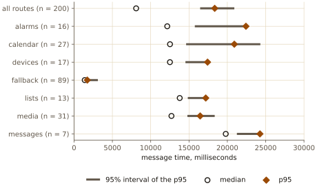
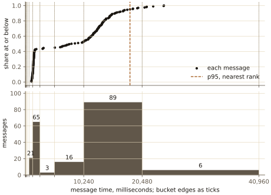

# Find where the latency comes from

By the end of this chapter you can say which step sets a message's time, at the median and in the tail, and print each number with its count and an interval around it. Ambrewick's assistant answers each message in up to five steps, and its traces show every step of a message but not which step sets the message's end. On baseline day 1, the {{out:percentiles-by-route:all routes, messages (n)}} messages this chapter reads, the median message took {{out:percentiles-by-route:all routes, median}}, and the 95th percentile took {{out:percentiles-by-route:all routes, p95}}. Was that time spent reading articles, writing the reply, or waiting on a tool?

Every time here comes from one recording machine, a 4-vCPU Intel Xeon at 2.10 GHz that ran Qwen3-4B-Instruct-2507 (the 4B). Each time is either a call's recorded time or a sum of them on the virtual clock described in [Replay and the virtual clock](#replay-and-the-virtual-clock). A message's time here is the recorded time of each call it made, plus the modelled time of the in-process tools and the recorded time of the contacts calls, added up on that clock. The recorder also kept the time between calls, and the replay leaves it out. Over the whole day that time totals {{out:critical-path-one-message:gaps between calls, recorded, all messages of the day}}, and each section says which of the two its numbers are.

The chapter builds the chain of calls that sets a message's end, the split of each model call into its reading and its writing, and then the tail, with a percentile and its interval for each route.

## The critical path sets the end time {#the-critical-path}

A message's trace is a tree of timed spans, and the root span ends when the reply goes out. Most spans sit inside the root, and most of them do not set that end. To find the ones that do, walk back from the root's end: take the child that ends last, then the child that ends last before that child starts, and keep going until the walk reaches the root's start. The critical path is the chain of spans that sets a message's end time; shortening any other span doesn't end the message sooner. Shorten a span on the chain and the message gets shorter, until another chain becomes the longer one.

[Example: critical-path-one-message](../examples/critical-path-one-message.py)

This run replays message {{out:critical-path-one-message:message}}, the longest message of the day, on the {{out:critical-path-one-message:route}} route, with its spans kept. The walk gives four links: the route call, an answer call, the `add_event` tool and a second answer call. The output gives each one's time, and the four add up to the message's {{out:critical-path-one-message:message time}}. The share of that time on the path is {{out:critical-path-one-message:share of the message time on the path}}, and the run asserts that the chain covers the whole message.

A replay can show that share because its calls run one after another, with nothing between them. The recorder's gaps have no span of their own, so a path built from spans would leave them off, and this message's replay has none of the day's gaps. The path covers the model calls, the modelled time of the in-process tools and the recorded time of the contacts calls, and nothing else. The retrieve step gets no time either, since its span starts and ends at one instant.

Overlap is the case a replay cannot show. No recorded message has two calls running at once, so the run builds a small tree by hand. Span a is the root and ends at 10. Span b runs from 0 to 6, and span c from 2 to 9. The walk from the end reaches c first and never returns to b, so the path is {{out:critical-path-one-message:constructed overlap, span IDs on the path}}. Span b is off the path, and shortening b does not move the end. That holds on this tree only. The path covers {{out:critical-path-one-message:constructed overlap, share of the root's time on the path}} of the root's time, so the spans on it explain only that much of the time. That is the low share the working rule warns of.

**Working rule:** Walk the critical path before you tune a trace, and change only the spans on it. Read the path's share of the message time first. A low share means the spans you have do not explain the time, and the rest belongs to no span. A replay's path always covers its message, so a replay cannot tell you which of two overlapping calls matters.

## Time to first chunk {#time-to-first-chunk}

The answer calls hold most of the path, so the next question is where inside a call the time goes. Time to first chunk is the time from sending a model call to receiving the first streamed piece of its reply. The conventions at tag {{out:validate-the-spans:GenAI conventions version}} measure that wait with the metric `gen_ai.client.inference.time_to_first_chunk`, which is a [histogram](#totals-from-metrics-not-spans) in seconds, on streaming calls only and only when a chunk arrives. The span attribute `gen_ai.response.time_to_first_chunk` measures from the start of the logical operation, before authentication and the first attempt, so a hosted client's [retries](#retries-under-a-timeout) count toward it. [Chapter 3's name table](#hand-made-against-instrumented) maps the package's name for the metric to the standard's.

The numbers in this section come from the recorder, not from the metric, which these examples do not run. The recorder timed the first stream event of each streamed reply, which this runtime sends together with the first content. A local model has no authentication step to add.

Each median in this section comes with a 95% interval, which [tail percentiles with intervals](#tail-percentiles-with-intervals) defines.

[Example: time-to-first-chunk-by-route](../examples/time-to-first-chunk-by-route.py)

The output takes each message's last answer call, the one that writes the reply the user reads, and sets its time to first chunk beside its total time, by route. Messages routed to the fallback reply make no answer call, which [chapter 1](#where-the-time-went-in-twenty-messages) describes, so the output counts them apart: {{out:time-to-first-chunk-by-route:messages with no answer call}} of them. The {{out:time-to-first-chunk-by-route:route calls, n}} route calls, which pick a route, reach their first chunk at a median of {{out:time-to-first-chunk-by-route:route calls, time to first chunk, median, all messages}}.

Answer calls take longer to produce that first chunk. Leaving aside the messages route, which has {{out:percentiles-by-route:messages, messages (n)}}, lists has the largest median first chunk, {{out:time-to-first-chunk-by-route:lists, time to first chunk, median}}, from {{out:time-to-first-chunk-by-route:lists, messages with an answer call}} messages. Its 95% interval, {{out:time-to-first-chunk-by-route:lists, time to first chunk, 95% interval}}, sits above every other route's but messages'.

On lists, the first chunk takes {{out:time-to-first-chunk-by-route:lists, time to first chunk, share of the call's time}} of the call's time. On the other routes that share runs from {{out:time-to-first-chunk-by-route:devices, time to first chunk, share of the call's time}} to {{out:time-to-first-chunk-by-route:messages, time to first chunk, share of the call's time}}.

The messages route needs the most care. Its median first chunk is {{out:time-to-first-chunk-by-route:messages, time to first chunk, median}}, from {{out:time-to-first-chunk-by-route:messages, messages with an answer call}} messages, and its 95% interval, {{out:time-to-first-chunk-by-route:messages, time to first chunk, 95% interval}}, is the widest in the output.

**Working rule:** Print time to first chunk beside the total time of the same call, and read the two together. An early first chunk means the user sees output early. It does not mean the call was cheap. Compare routes on their intervals and on the share, and do not name a route's first chunk from a handful of messages.

## Prefill against generation {#prefill-against-generation}

The first chunk waits on the prompt, so the next question is how much of that wait is reading the prompt and how much is something else. Prefill is the model reading the prompt; generation is it writing the reply, one token at a time. Serving papers for GPUs make the same split: prefill keeps the compute busy, and each decoding step leaves most of it idle ([Agrawal et al., Sarathi-Serve](https://www.usenix.org/conference/osdi24/presentation/agrawal), OSDI 2024; [Yu et al., Orca](https://www.usenix.org/conference/osdi22/presentation/yu), OSDI 2022, for one output token per iteration).

The counts in this section need no new definition. [Chapter 6](#three-token-counts) says where input and output tokens come from, and [its cached-input section](#cached-prompt-tokens) says how the cached share is derived. The tokens evaluated are what remains of the input once the cached prefix is taken away, which is the input the model actually read.

The counters come from llama-cpp-python, which exposes llama.cpp's counters for each context: the prompt tokens evaluated and the time they took, and the tokens generated and the time they took. The counters only add up, so the recorder takes the difference before and after each call. Its four warm-up calls, made before each process's first recorded message, are outside the split.

[Example: prefill-generation-split](../examples/prefill-generation-split.py)

The output splits each step's compute into the two kinds of work, route calls first. The route calls read a fixed instruction and the message, and the answer calls read the message and whatever the route fetched. A route call's first chunk waits for its prompt: prefill is {{out:prefill-generation-split:route, prefill share of time to first chunk}} of that wait, though only {{out:prefill-generation-split:route, prefill share of prefill plus generation}} of the call's compute. The answer calls wait on the same thing in larger measure. Prefill is {{out:prefill-generation-split:answer, prefill share of time to first chunk}} of their wait for the first chunk, so the first word of a reply is mostly the prompt being read.

Generation on the answer calls runs at {{out:prefill-generation-split:answer, tokens written per second of generation, computed}} tokens a second, and prefill reads {{out:prefill-generation-split:answer, prompt tokens evaluated per second of prefill, computed}} tokens evaluated a second. Those rates are computed from the counts and hold for this machine, for the reason that [Small Open Models](https://rollingedition.com/small-open-models/s/measure-speed-in-a-recording) gives: a small model's speed is measured in a recording on one named machine and never quoted as a rule. Prefill is counted in tokens evaluated, not in input tokens, and the [next section](#retrieved-context-against-prefill) shows why that choice matters.

**Working rule:** Split a model call's time into prefill and generation before you change its prompt or its reply length. Take the split from the counters, on the same machine and the same calls, and read it beside the total. When prefill is most of the time to first chunk, the prompt is where the wait is. When generation is most of the call, the reply's length is.

## Retrieved context against prefill {#retrieved-context-against-prefill}

Retrieval puts articles into the answer call's prompt, so a release that retrieves more should make prefill longer. The question for that release is how much longer, and whether the model reads all of the added input. The top-8 release gives the answer call up to eight articles, where the baseline gives up to three, on the routes that retrieve. Route calls come before retrieval, so their prompts hold no articles in either release.

The comparison uses the same messages under both releases, the paired 60: the messages of baseline day 1 that the top-8 release was also recorded on. The output's r0 is the baseline and r3 is the top-8 release. It sums each release's answer calls over those messages, and that is a sum, not a comparison with an interval. Chapter 10 pairs the same messages and gives the interval on the difference.

[Example: context-against-prefill](../examples/context-against-prefill.py)

On the paired messages, the answer calls take {{out:context-against-prefill:r3, prefill summed over the answer calls}} of prefill under the top-8 release, against {{out:context-against-prefill:r0, prefill summed over the answer calls}} under the baseline: {{out:context-against-prefill:prefill, r3 over r0, computed}} times as much. The output also gives two correlations over every answer call of baseline day 1.

The input grows with the articles. Input tokens rise from {{out:context-against-prefill:r0, prompt tokens summed over the answer calls}} to {{out:context-against-prefill:r3, prompt tokens summed over the answer calls}}, and tokens evaluated, the input the model read, rise from {{out:context-against-prefill:r0, prompt tokens evaluated summed over the answer calls}} to {{out:context-against-prefill:r3, prompt tokens evaluated summed over the answer calls}}.

Both releases skip about the same cached prefix, {{out:context-against-prefill:r0, cached prompt tokens summed over the answer calls}} tokens under the baseline and {{out:context-against-prefill:r3, cached prompt tokens summed over the answer calls}} under the top-8 release, so the model reads the added input. Under the top-8 release, {{out:context-against-prefill:paired answer calls, r3 with more prompt tokens than r0}} paired answer calls gained prompt tokens, and none lost any.

The route calls show a gap without any article in their prompts. Under the top-8 release they evaluate {{out:context-against-prefill:r3, prompt tokens evaluated summed over the route calls}} tokens, against {{out:context-against-prefill:r0, prompt tokens evaluated summed over the route calls}} under the baseline, on prompts the example asserts are identical under both releases.

The cause is the recorder's cache. The cache is bounded at 1 GiB and drops its oldest state first, so a route call that runs after enough others finds its instruction gone and reads it again. The recording logs no cache hits, so this follows from the cache's rule and not from a log. The cache holds the instruction, {{out:context-against-prefill:route instruction, cached tokens in most route calls}} tokens, for most route calls. Under the top-8 release, {{out:context-against-prefill:r3, route calls that re-read most of the instruction}} route calls re-read most of it, against {{out:context-against-prefill:r0, route calls that re-read most of the instruction}} under the baseline.

Prefill follows tokens evaluated rather than input. Across baseline day 1's answer calls, prefill correlates {{out:context-against-prefill:prefill against tokens evaluated, correlation, computed}} with tokens evaluated and {{out:context-against-prefill:prefill against prompt tokens, correlation, computed}} with input. A prefix the model has read before is not read again while the cache holds it, so input can grow while the work does not, and the tokens a call evaluates depend on the calls before it.

**Working rule:** Measure a prompt's extra prefill on the same messages as the release it changes, and read tokens evaluated beside input tokens. Input tokens say how large the prompt is. Tokens evaluated say how much work the model did, and when a prefix is cached the two counts part company. Act on the work.

## Tail percentiles with intervals {#tail-percentiles-with-intervals}

The medians so far leave out the messages that wait longest, and those are the ones a tail percentile is for. This book uses the nearest rank. The p-th percentile is the value at sorted position ceil(p/100 × n); the tail is the slowest few percent of messages. Sort the n values, count to position ceil(p/100 × n), and take the value there. It always returns a message that occurred.

[Chapter 1](#whats-rough) said that twenty messages cannot support a tail percentile. Two hundred can, with an interval beside it, and every percentile in this chapter states its count, n. A percentile of seven messages is a different kind of number from one of 200, and the output shows which.

The rule has a consequence at the top of the list. On 200 values the 99th percentile is the value at position {{out:percentiles-by-route:p99 of the values 1 to 200 (n = 200), nearest rank}}, which is the third largest, not the second. The output prints the rule on the values 1 to 200 so that the position is visible.

Predict before you run it. How many messages does a route need before its 95th percentile is anything but its slowest message? Work it from ceil(0.95 × n), then check the output.

[Example: percentiles-by-route](../examples/percentiles-by-route.py)

The output gives each route's median, 95th and 99th percentile, each with its count, and a 95% interval on each 95th percentile. A route needs at least {{out:percentiles-by-route:fewest values before the p95 is not the largest, nearest rank}} messages before its 95th percentile is anything but its largest. {{out:percentiles-by-route:routes under 20 messages, count}} routes have fewer than 20 messages, {{out:percentiles-by-route:routes under 20 messages, p95 is their largest message}}, and for each one the 95th percentile is its slowest message.

The messages route's 95th percentile is {{out:percentiles-by-route:messages, p95}} from {{out:percentiles-by-route:messages, messages (n)}} messages, with a 95% interval of {{out:percentiles-by-route:messages, p95, 95% interval}} whose top is the same value. Its last answer calls are the longest of the answering routes at the median, at {{out:time-to-first-chunk-by-route:messages, total time of the answer call, median}}. The output does not say why its tail is long.

The all-routes median, {{out:percentiles-by-route:all routes, median}}, is lower than the median of every route that answered. The reason is the fallback route. {{out:percentiles-by-route:fallback, messages (n)}} of the {{out:percentiles-by-route:all routes, messages (n)}} messages took the fallback reply, which makes one route call and no answer call, and their median is {{out:percentiles-by-route:fallback, median}}. The all-routes median is the middle value of all the messages, so those messages pull it down.

[Example: figure-latency-tail-by-route](../examples/figure-latency-tail-by-route.py)

{{fig:latency-tail-by-route}} draws each route's median and 95th percentile, with the interval on the 95th percentile as a bar. The top row is all routes together. Read the answering routes' bars against one another. Most of their intervals overlap, and the messages interval overlaps calendar's, as the example asserts. The {{out:percentiles-by-route:routes under 20 messages, count}} routes under 20 messages have bars that end at their own largest message. The fallback bar is far shorter than the rest. So the tail depends on whether the route answers, and the count decides how sure the reader can be of where a route's tail sits.

The interval is a percentile bootstrap, and this is the one place the chapter builds it. An interval says how far a number would move had the day brought other messages drawn the same way; here, the middle 95% of 2,000 bootstrap resamples of messages. The question behind it is whether another day's 95th percentile would be the same. The interval answers that only for a day drawn the same way. A different day, a release or a load lies outside what it covers.

For each route, the code draws as many messages as the route has, with replacement, takes the 95th percentile of that resample, and repeats the draw 2,000 times with the seed 20261207. The interval is the 50th and the 1,950th of the 2,000 results, which bracket 95% of them. [Efron](https://doi.org/10.1214/aos/1176344552) introduced the bootstrap in 1979, and [Evaluating LLM Applications](https://rollingedition.com/evaluating-llm-applications/s/bootstrap-over-items) uses the same method over items. Here the unit is the message, not the span, because the spans of one message are not independent of one another.

The same bootstrap applies to any statistic taken per message, such as the share of the day's cost that the most expensive messages carry in [chapter 6](#the-expensive-tail). Under 20 messages, though, the 95th percentile of every resample is one of the route's own messages, and the largest of them is the top of the interval. The interval cannot reach past the messages it came from. So for each of the {{out:percentiles-by-route:routes under 20 messages, count}} routes under 20 messages, the upper end is its own largest message, the upper end and the point estimate are one value, and the interval's width measures the resampling, not what those few messages leave out.

**Working rule:** Print each percentile with its count and its interval, and rank two routes only when their intervals do not overlap. Collect more messages before you name a tail.

## Histogram buckets and what they hide {#histogram-buckets-and-what-they-hide}

A histogram keeps no messages, only counts. A bucket counts the values between two edges, so a percentile read from buckets is known only to within its bucket. The GenAI conventions at tag {{out:bucket-edges-hide-tail:GenAI conventions version}} say the boundaries SHOULD be these, in seconds, for their duration histograms, the agent's `gen_ai.client.invoke_agent.duration` included. The book uses them for message time, the duration this chapter measures: {{out:bucket-edges-hide-tail:bucket boundaries, GenAI conventions, seconds}}. A service exports the edges its configuration sets, which may not be these.

[Example: bucket-edges-hide-tail](../examples/bucket-edges-hide-tail.py)

The output counts the same messages of baseline day 1 into those buckets, estimates the 95th percentile from the counts, and sets the estimate beside the nearest-rank value of the raw messages. The bucket holding the 95th percentile runs from {{out:bucket-edges-hide-tail:bucket holding the p95, lower edge}} to {{out:bucket-edges-hide-tail:bucket holding the p95, upper edge}}. It holds {{out:bucket-edges-hide-tail:messages in that bucket}} messages, and {{out:bucket-edges-hide-tail:messages at or below its lower edge}} messages sit at or below its lower edge.

The buckets place the 95th percentile between those edges, and no closer. The estimate spreads the messages in the bucket evenly across it. That is the rule of [Prometheus's percentile estimate from buckets](https://raw.githubusercontent.com/prometheus/prometheus/v2.53.0/promql/quantile.go), which assumes a linear distribution within a bucket. Other backends may interpolate differently, so the estimate moves when the edges move. Here the estimate is {{out:bucket-edges-hide-tail:p95, estimated from the bucket counts}} and the nearest-rank value of the raw messages is {{out:bucket-edges-hide-tail:p95, nearest rank of the raw values}}, so the estimate is {{out:bucket-edges-hide-tail:estimate minus the nearest-rank p95}} too high on this day.

[Example: figure-bucket-hides-tail](../examples/figure-bucket-hides-tail.py)

{{fig:bucket-hides-tail}} draws the same messages twice on one millisecond scale. The upper panel plots each message at the share of messages at or below it, so the points climb. The dotted lines are the bucket edges, and the dashed line is the nearest-rank 95th percentile. The lower panel shows each bucket's count, drawn across the range the bucket covers. The 95th-percentile line falls inside a wide bucket, and nothing in the lower panel says where in that bucket the messages sit. That is what a bucket loses, and it is why the estimate is off.

**Working rule:** Set bucket edges from the question you will ask, and put an edge near each threshold you alert on. When a percentile falls inside a wide bucket, report the bucket and its count rather than an estimate to the millisecond, and keep the raw values whenever you can. An estimate from buckets is one rule applied to one set of edges, and it moves when the edges move.

## Queueing on recorded service times {#queueing-on-recorded-service-times}

A message's time is not only its own work. When a message arrives while the model is busy with another, it waits, and the wait is part of the time the user sees. A queue shows how that wait grows with load. Each arrival joins a line, the server takes one message at a time, and the load is the share of the server's time that arrivals ask for.

The numbers in this section are computed, not recorded. The code models one server. Its arrivals come at random, at a fixed average rate set by the load, which is a Poisson process: the gaps between arrivals are independent, with an exponential spread. Each message's service time is one of the day's recorded message times, drawn with replacement. Little's law says that the average number in a system equals its arrival rate times the average time each item spends in it, L = λW. [Little's 1961 proof](https://doi.org/10.1287/opre.9.3.383) establishes it, and [MIT's course notes on the M/M/1 queue](https://ocw.mit.edu/courses/2-854-introduction-to-manufacturing-systems-fall-2016/927056a1af54772a587fd84ad4951e71_MIT2_854F16_Mm1Queue.pdf) state it in the form used here.

[Example: queue-on-service-times](../examples/queue-on-service-times.py)

The output covers loads of 0.5, 0.8 and 0.9, each with the same seed, and then one more check where a formula exists. The mean recorded message time is {{out:queue-on-service-times:mean recorded message time}}, the service each message takes on average, and at a load of 0.5 the server's utilisation is {{out:queue-on-service-times:load 0.5, utilisation, computed}}.

The 95th-percentile wait before service is {{out:queue-on-service-times:load 0.5, wait before service, computed, p95 (n = 50,000)}} at load 0.5, {{out:queue-on-service-times:load 0.8, wait before service, computed, p95 (n = 50,000)}} at 0.8, and {{out:queue-on-service-times:load 0.9, wait before service, computed, p95 (n = 50,000)}} at 0.9. The waits climb more steeply than the load.

The number in system follows the same curve. At load 0.8 it averages {{out:queue-on-service-times:load 0.8, number in system, time average, computed}}, and the arrival rate times the time in system gives {{out:queue-on-service-times:load 0.8, arrival rate times time in system, computed}}. The code finds the first from the queue's events over time and the second from the arrival rate and the mean time in system, and asserts that they are equal at every load. On a sample path whose window runs from the first arrival to the last departure, Little's law holds exactly, so the assert allows no tolerance.

The M/M/1 formula, the mean time in system for one server with exponential service, is exact only for exponential service times, and the recorded times are not exponential. So the code checks the simulation on its own terms first. With exponential service at load 0.8 over 200,000 messages, the simulated mean time in system is {{out:queue-on-service-times:exponential service, load 0.8, mean time in system, simulated (n = 200,000)}}, and the formula gives {{out:queue-on-service-times:exponential service, load 0.8, mean time in system, formula}}. The code asserts that the two agree within 2%. M/G/1, a single server with any service distribution, has a mean formula of its own, and this chapter leaves that check out.

This is a model of one server, not of Ambrewick's deployment. Each message's whole recorded time is one service, which is how the queue treats a message, and its arrivals ignore the day's real arrival times. The waits are therefore what one server with this mix of messages would give, and they are not what the day did.

**Working rule:** Read a queue at the load you expect and at a higher one before you accept a tail or add capacity. Use recorded service times when you have them, label every number the simulation computes, and check the simulation against a formula only where the formula's assumptions hold.

## What goes wrong in production {#latency-sources-in-production}

Three things change when these numbers leave the replay. First, production spans leave gaps. The recorder's gaps between calls total {{out:critical-path-one-message:gaps between calls, recorded, all messages of the day}} over the day. They are real time in the message, but they belong to no span, so a critical path built from spans can cover less than the message's full time. Read the path's share beside the message time, and treat a low share as a question for the trace, not as an answer.

Second, the histogram a service exports has the edges its configuration sets, which may not be the conventions' advised ones. A percentile read from buckets takes on the [error](#how-a-span-records-failure) of its edges, as the bucket estimate shows on this day's messages. Chapter 9 sets its objectives on these latencies, so the edges belong in that decision as well.

Third, a route with few messages a day gets a 95th percentile with a wide [interval](#tail-percentiles-with-intervals), and a dashboard that shows only the point looks exact. Put the count and the interval on the same panel, or leave the percentile off it.

**Working rule:** Before you publish a latency number from production, print its count and its interval beside it, and say which kind of time it is: a span's time, a bucket's estimate, or a replay's sum. When the path's share or the bucket's edges are unknown, state that with the number instead of letting the number stand alone.

## The decisions this chapter made {#latency-sources-decisions}

Each of these is a judgement we could get wrong. Each gives its reason and the example that tests it.

- We read the critical path from the spans, and we show the overlap case on a constructed tree, because no recorded message has overlapping calls. `critical-path-one-message` checks that the path covers the whole replayed message, and that the constructed tree's span b is off the path.
- We report time to first chunk beside the same call's total time, and we split it with the counters, so that a first chunk is never read alone. `time-to-first-chunk-by-route` and `prefill-generation-split` print both on the same calls.
- We print nearest-rank percentiles with their counts, and an interval on each 95th percentile from seeded bootstrap resamples of messages. `percentiles-by-route` names the routes under 20 messages, whose 95th percentile is their largest message, and checks the one overlap the prose relies on.
- We use the edges the GenAI conventions advise for message time, and we say so, because a service's own edges may differ. `bucket-edges-hide-tail` prints the estimate's error on this day, and `figure-bucket-hides-tail` draws the raw values beside the counts.
- We simulate queues only on recorded service times, and we label every queue number computed. `queue-on-service-times` finds the number in system from the queue's events and checks it against the arrival rate times the time in system at each load, and it checks the M/M/1 formula only with exponential service.
- We rank routes' tails only where their intervals do not overlap, because one day of messages cannot order them. On this day that leaves most of the answering routes unordered, so the firm difference is whether a route answers at all, not which answering route has the worst tail.
