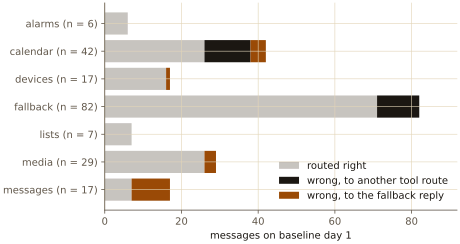

# Find the step that failed

By the end of this chapter you can find which step of a message failed, how often, and why, and print each count with the rows it came from. The case puts the question plainly. A user who got no useful answer cannot tell from the log why. The router may have sent the request to the wrong route, or to the fallback reply. The model may have written a tool call the parser cannot read, or a reply cut off at its token cap. The contacts server may have returned an error, or no answer at all. Which of these happened, and how often?

Baseline day 1 answers the how-often question from its real replies. Of its {{out:wrong-routes-by-label:baseline day 1 (4B), messages}} messages, {{out:failure-modes-query:wrong routes, baseline day 1 (real)}} went to the wrong route, and not one span ended in error. Those are the day's real failures. The incident day needs a second kind of count, because we injected its faults: a window in which the contacts server answers too late, one in which the model refuses every request, and one in which the contacts server returns error results. Each injected fault is labelled, and its counts sit in their own rows, never folded into baseline day 1's rates. Every table that prints an injected count repeats the label, and nothing on the incident day is a real outage.

The replays run on the virtual clock of [Replay and the virtual clock](#replay-and-the-virtual-clock). The case's traffic was generated for this book, so the rates here are the book's own and describe no service.

The chapter builds one query per failure mode, from the status a span records to the wrong route.

## How a span records failure {#how-a-span-records-failure}

A span records its outcome in its status. The conventions ask instrumentation to set the status to `Error` when an operation ends with an error, and to leave it unset when nothing went wrong ([recording errors](https://raw.githubusercontent.com/open-telemetry/semantic-conventions/v1.45.0/docs/general/recording-errors.md), v1.45.0). The same page asks for `error.type` on a failed operation.

A span's status is unset, ok or error. `error.type` names the error: the class name the package writes, or a registry value where one exists, so failures can be counted by kind. We invent no registry value.

We use one more word for the same thing. An error is a span whose status is ERROR. A message has an error when any of its spans is ERROR. That is the error chapter 10's [the CI gate](#the-ci-gate) counts. Two other bad outcomes are not errors. A reply cut at its token cap is a quality finding, and so is a route reply that names no route. Both are counted below, and neither sets a span's status.

The registry offers few values to choose from. Its fallback is `_OTHER`, and it has no value for a timeout or for an HTTP 429, which are the two failures this chapter meets most. The registry asks for values that are predictable and [low in cardinality](#cardinality), and it lists `timeout` and `500` as examples, not as defined values ([error.md](https://raw.githubusercontent.com/open-telemetry/semantic-conventions/v1.45.0/docs/registry/attributes/error.md), v1.45.0). So we write the class name the package raises: `MCPError` for a read timeout, `RateLimitError` for a refused model request, and `ModelUnavailable` for the assistant's own give-up. We write the short class name, where the registry's examples are fully qualified. Other instrumentation writes the qualified one, such as the openai instrumentation's `openai.RateLimitError`, and the assistant's own `exception.type` on the same span is qualified. The injected 429 raises the book's `RateLimitError`, which stands in for the client's exception of that name. The value is therefore the book's, and a deployment that uses the client's own exception will read a different class name in the same place.

An exception is recorded apart from the status. When the OpenTelemetry Python SDK, {{version:opentelemetry-sdk}} in this book, records an exception, it adds an `exception` event to the span and leaves the status unset. The two helpers that wrap a span, `start_as_current_span` and `use_span`, are the exception to that: when an exception escapes them, they also set the status to ERROR by default. The recording-errors page asks for a different place: it says an exception that fails an operation should be recorded as a log record. We recommend keeping the SDK's event while the receiver holds spans. Every query in this chapter reads spans, and the counts depend on the status. A deployment with a log pipeline can take the other route, as long as the status and `error.type` still reach the spans.

[Example: error-status-by-step](../examples/error-status-by-step.py)

Baseline day 1, replayed, has no ERROR span at all, and that zero is the point: a wrong route sets no status. So the day's real failures are not in this table at all, and the rest of the chapter counts them another way. The incident day runs live, so that the contacts server applies its faults. It has {{out:error-status-by-step:ERROR spans, incident day (injected)}} ERROR spans, and the example asserts that every one of them carries the injected label.

Read the rows by status first, and by `error.type` second. Some ERROR spans carry no `error.type` at all. The MCP SDK's client span, `MCP send tools/call find_contact`, for a timed-out call is one kind: there are {{out:error-status-by-step:MCP send tools/call find_contact, error.type none, injected}} of those. The contacts server's `contacts.lookup` span for an injected crash is the other: {{out:error-status-by-step:contacts.lookup, error.type none, injected}} of those. The default described above sets ERROR when the crash escapes the span, and nothing sets `error.type`. A count by `error.type` alone would miss both. The other rows are the kinds the later sections explain. Refused model requests carry `RateLimitError`, {{out:error-status-by-step:chat qwen3-4b-instruct-2507, error.type RateLimitError, injected}} of them. Messages that got no reply end with a root span that reads `ModelUnavailable`, {{out:error-status-by-step:invoke_agent ambrewick-assistant, error.type ModelUnavailable, injected}}. The contacts calls that failed appear under three names: `execute_tool find_contact` on the assistant's attempt, `MCP send tools/call find_contact` on the client span, and `tools/call find_contact` on the server's span. The sections on timeouts and error results read each one.

**Working rule:** Count failures by span status, and print each `error.type` beside its count. A span with no `error.type` is still an error, so never filter on the attribute to find failures. Keep real and injected counts in separate rows, and label each injected row where it appears.

## Replies cut at the cap {#replies-cut-at-the-cap}

The status rule in [the first section](#how-a-span-records-failure) catches a failure that raises, and a reply cut at its token cap raises nothing. Some replies stop because the model reached that cap, not because it finished. The assistant records the runtime's finish reason in `gen_ai.response.finish_reasons`, an array with one entry per generation, in the order of the generation's choices. The finish reason says why the model stopped: on its own (`stop`) or at the token cap (`length`). The GenAI conventions, at {{out:validate-the-spans:GenAI conventions version}}, define the inference span's values in the same terms: an interrupted generation reports the provider's reason or `interrupted`, and `error` is reported when a reason was expected and not received ([client inference span](https://raw.githubusercontent.com/open-telemetry/semantic-conventions-genai/v0.1.0/docs/gen-ai/client-inference.md), note 18). So a `length` reply is not an error, and we do not count it as one. [The agent harnesses' finish reason](https://rollingedition.com/concepts/large-language-models/finish-reason) is the same idea.

Two facts about this runtime shape the check. First, it never reports `tool_calls`. A model's tool call comes back as text inside the reply, and the finish reason stays `stop`, so the finish reason cannot show a tool call. The next section deals with that case. Second, the answer step has a cap of {{out:truncated-replies:model swap, answer cap in tokens}} tokens. The cap is the same in every release and recording. It was set once, before any recording this book reads, and no recording was edited to produce a cut.

[Example: truncated-replies](../examples/truncated-replies.py)

No reply from the 4B reached the cap. Its {{out:truncated-replies:baseline day 1, route requests, finish reason stop}} route replies and {{out:truncated-replies:baseline day 1, answer requests, finish reason stop}} answers all stopped on their own, and the replay's chat spans carry the same reasons: {{out:truncated-replies:baseline day 1, chat spans replayed with finish reason stop}} of them, all `stop`.

The model-swap release runs Qwen3-0.6B, and it adds `/no_think` to its prompt, so its differences from baseline day 1 come from the smaller model and the suffix together. Here the cut shows up. None of its route replies was cut, and its answer step cut {{out:truncated-replies:model swap (0.6B, release r2), answer requests, finish reason length}} reply, at {{out:truncated-replies:model swap, cut answer, completion tokens}} tokens, which is the cap.

That cut reply is a quality finding. The span is not an error, and the user receives a reply that stopped short. We file it under quality and read the text before deciding what it means.

**Working rule:** Count the `length` finish reasons for each step on every release, before you call its replies complete, and print the cap beside the count. A zero on one recording says nothing about another. Read a cut reply as a quality finding, and never file it as an error.

## Tool calls that do not parse {#tool-calls-that-do-not-parse}

When the model wants a tool, it writes a `<tool_call>` block into its reply, and the assistant reads the block back. The runtime's finish reason cannot show a bad block, because a reply with a broken block still stops on its own. A malformed call is found only by parsing the reply. A block with no closing tag is malformed. So is a body that is not JSON, a call with no name, or one whose arguments are not an object. Each malformed call is counted once on its message, and the assistant tells the model that the call could not be read and asks it to answer without a tool.

A different failure reaches the tool itself. A call can parse and still fail the argument model of its tool. That is not a malformed reply. The tool attempt ends ERROR, with `error.type` set to the class `ValidationError`, and [the query section](#querying-each-failure-mode) counts those among the tool attempts.

[Example: malformed-tool-calls](../examples/malformed-tool-calls.py)

No recorded reply on baseline day 1 held a broken block. The 4B wrote {{out:malformed-tool-calls:baseline day 1 (4B), answer replies}} answer replies, {{out:malformed-tool-calls:baseline day 1 (4B), replies with a tool call}} of which carried a tool call, and the parser rejected {{out:malformed-tool-calls:baseline day 1 (4B), malformed tool calls}} of them. The replay's outcome, which counts parse failures and schema rejections together, finds {{out:malformed-tool-calls:baseline day 1 (4B), malformed tool calls in the replay}}, which agrees.

The model-swap release, Qwen3-0.6B with `/no_think` on its prompt, wrote {{out:malformed-tool-calls:model swap (0.6B, release r2), answer replies}} answers, and only {{out:malformed-tool-calls:model swap (0.6B, release r2), replies with a tool call}} of them carried a tool call. That call parsed. One call tests nothing about a small model's tool use, so this section makes no claim about it.

Neither recording holds a broken block. To show what the parser refuses, we pass two replies written for this chapter straight to it, and it rejects both. The replies were never recorded and never become spans, rows or recordings, so they say nothing about the recorded day.

The receiver cannot find a parse failure, though. A malformed reply raises inside the assistant and is counted on the message's outcome, and no span records it as an error. The count above therefore comes from the replies. [The query section](#querying-each-failure-mode) says what the receiver can and cannot show.

**Working rule:** Parse every reply that could carry a tool call, and count malformed replies with the parser's own count, never with a finish reason. Print the replies that carry a call beside that count, so a reader can see how small a sample of tool use it is.

## Retries under a timeout {#retries-under-a-timeout}

The status rule in [the first section](#how-a-span-records-failure) catches a failure that raises, and the first injected fault is one: a timeout raises across the process boundary. The contacts server is a separate process, and `find_contact` runs there, so its failures reach the assistant as the MCP SDK raises them. We injected this fault into the incident day. Between {{out:retries-under-incident:inc-contacts-timeout (injected), window start (UTC)}} and {{out:retries-under-incident:inc-contacts-timeout (injected), window end (UTC)}} UTC, the contacts server answers `find_contact` only after the client's read timeout of {{out:retries-under-incident:inc-contacts-timeout (injected), read timeout}}, and the client gives up. The tool wrapper waits and tries once more. [Chapter 4](#errors-across-the-boundary) explains how the SDK raises that timeout as an exception and not as a reply.

A retry is another attempt at a failed call, recorded as its own span. We recommend one span per attempt, and we record each attempt of a tool call as its own `execute_tool` span, with an `ambrewick.attempt` number. A failed attempt is therefore an ERROR span, and the call's success appears on the attempt that succeeded. No span describes the whole call. [Chapter 4's choice](#errors-across-the-boundary) gives the reason, and the first attempt's timeout is one of the failures the user's message met, so it counts.

[Example: retries-under-incident](../examples/retries-under-incident.py)

Here the incident day runs live, so the contacts server applies the fault, and each span is grouped by its window. Every line names its window and says injected. In the timeout window, the timed-out attempts were {{out:retries-under-incident:inc-contacts-timeout (injected), attempts that time out}}. Each ends ERROR, with `error.type` `MCPError` and the MCP code on `ambrewick.mcp.error_code`. The code is {{out:retries-under-incident:inc-contacts-timeout (injected), MCP error code}}, the SDK's name for a read timeout and not a protocol code, as [chapter 4](#errors-across-the-boundary) says. The retries were {{out:retries-under-incident:inc-contacts-timeout (injected), retries}}. Both timed-out messages' retries timed out too, so the tool returned its timed-out reply to the model. Each second attempt starts {{out:retries-under-incident:inc-contacts-timeout (injected), retry starts after the first attempt}} after its first, which is the read timeout plus the wait before the retry.

The model's window works the same way, but its failures are refusals. Every model request in the window is answered with a 429, and the assistant retries with a backoff. Each refused attempt is a zero-length chat span, ERROR, with `error.type` `RateLimitError`, and the injected window refused {{out:error-status-by-step:chat qwen3-4b-instruct-2507, error.type RateLimitError, injected}} requests. Once the backoff runs out, the message ends with no reply: {{out:error-status-by-step:invoke_agent ambrewick-assistant, error.type ModelUnavailable, injected}} messages did. One message got a reply after a refused attempt, which is {{out:retries-under-incident:inc-rate-limit (injected), messages that got a reply after a refused attempt}}. By the span rule, that message counts as an error, although its user got the reply. The count follows the spans. [The production section](#find-the-failure-in-production) says what that does to a rate.

**Working rule:** Count a failed attempt as a failure even when the call later succeeds, and name its window before you count it as injected.

## MCP errors {#mcp-errors}

The contacts server has a second way to fail, and it raises nothing. The MCP tools specification says that a tool's own failure comes back as a result with `isError` set, and not as a protocol error ([tools](https://modelcontextprotocol.io/specification/2026-07-28/server/tools), revision 2026-07-28). The MCP Python SDK, {{version:mcp}} in this book, follows that rule. The injected `mcp-error` window makes every `find_contact` call in its window come back as an error result, and the client hands the result back to the assistant as a reply.

An error result is not an exception, so there is no exception to name. The attempt ends ERROR with `error.type` `tool_error`, the value that the MCP conventions define for an `isError` result ([MCP conventions](https://raw.githubusercontent.com/open-telemetry/semantic-conventions-genai/v0.1.0/docs/gen-ai/mcp.md), v0.1.0). Its status description reads "find_contact returned an error result". No exception event is written, and no retry follows.

The incident day's rows show the three records. The assistant recorded {{out:error-status-by-step:execute_tool find_contact, error.type tool_error, injected}} attempts as `tool_error`, and the server recorded the same calls as `tool_error` too, {{out:error-status-by-step:tools/call find_contact, error.type tool_error, injected}} of them. The window's retries line reads {{out:retries-under-incident:inc-mcp-error (injected), retries}}, so none of these attempts was retried. The contacts server's `contacts.lookup` span is also ERROR for these calls, and it carries no `error.type`. The conventions ask for `tool_error` on the client span too, and for `error.type` on any failed client span, the exception's class name for a timeout. The MCP SDK at {{version:mcp}} departs from both: its client span for an error result stays unset, and its span for a timeout is ERROR with no `error.type`. The only client-side ERROR rows in [the first table](#how-a-span-records-failure) are the {{out:error-status-by-step:MCP send tools/call find_contact, error.type none, injected}} timeouts.

One injected fault therefore leaves three ERROR records. A count of spans by status counts it three times. The failure a user's message met is the attempt, because that is the operation the message's own call made. The server's spans are the cause, and they join the message's trace through the context that [chapter 4](#traceparent-in-meta) propagates. The [query section](#querying-each-failure-mode) pairs each error-result attempt with the server span in its trace: {{out:failure-modes-query:error-result attempts paired with their server span, incident day (injected)}} pairs.

**Working rule:** Count a failed operation once, on the span the caller made, and read the server's span beside it for the cause. With the MCP SDK at this version, expect the client's span to stay unset for an error result, though the conventions ask for `tool_error`; count by the caller's attempt either way.

## Wrong routes against the labels {#wrong-routes-against-labels}

A wrong route is the one failure with no error anywhere in the trace. The call succeeds, its reply stops on its own, and the answer is a fallback reply, or a tool route the message did not need. To find it, the book needs a source of truth, and the case has one. MASSIVE labels each utterance with a scenario. The scenario table maps each scenario to one route, and the routes are `calendar`, `alarms`, `lists`, `messages`, `devices`, `media` and `fallback`. A scenario goes to the route whose tool or articles resolve it, and to `fallback` only when no tool and no article do. A wrong route is a routed choice that differs from the table's. The router writes its choice on the route span, and the check event on that span holds the table's answer, so the trace records whether the route was right.

The fallback reply is defined in [chapter 1](#where-the-time-went-in-twenty-messages). The table adds the rule for when it is the right answer. It is right for a message that no tool or article resolves, and for no other message. A fallback reply to any other scenario is a wrong route that the user sees as a refusal. The check is code, and it reads the trace, not the reply's text. Judging whether an answer is right is a separate job, and [Evaluating LLM Applications](https://rollingedition.com/concepts/llm-evaluation/code-check) covers the checks that read a reply.

The dev day shows the case in small. Of its {{out:wrong-routes-by-label:dev day, messages}} messages, {{out:wrong-routes-by-label:wrong routes, dev day (20 messages)}} were routed wrong, and {{out:wrong-routes-by-label:fallback replies to a scenario that is not fallback, dev day}} of those got the fallback reply for a scenario that needed a tool or an article.

[Example: wrong-routes-by-label](../examples/wrong-routes-by-label.py)

On baseline day 1 the 4B routed {{out:failure-modes-query:wrong routes, baseline day 1 (real)}} of its messages wrong. The 95% interval runs from {{out:wrong-routes-by-label:wrong routes, baseline day 1, 95% interval}}, from {{out:wrong-routes-by-label:bootstrap resamples of messages, baseline day 1}} resamples of messages.

For one day of {{out:wrong-routes-by-label:baseline day 1 (4B), messages}} messages that interval is wide, and the rate should be read with it. Of the wrong routes, {{out:wrong-routes-by-label:fallback replies to a scenario that is not fallback, baseline day 1}} were fallback replies to scenarios that needed a tool or an article. The rest went to a tool route.

The routes differ a great deal. Of the messages whose scenario belongs to the messages route, {{out:wrong-routes-by-label:messages, wrong routes of 17 messages}} of {{out:figure-failure-modes-by-route:route messages, messages (n)}} were wrong, and every one of them was a fallback reply. Calendar was the other large case: {{out:wrong-routes-by-label:calendar, wrong routes of 42 messages}} of {{out:figure-failure-modes-by-route:route calendar, messages (n)}} were wrong.

The fallback scenarios show the opposite error. They went to a tool route {{out:wrong-routes-by-label:fallback, wrong routes of 82 messages}} times, out of {{out:figure-failure-modes-by-route:route fallback, messages (n)}}. The alarms and lists routes had no wrong routes at all, but with {{out:figure-failure-modes-by-route:route alarms, messages (n)}} and {{out:figure-failure-modes-by-route:route lists, messages (n)}} messages, those zeros say little.

The model-swap release routed {{out:wrong-routes-by-label:wrong routes, model swap (0.6B, release r2)}} wrong, and {{out:wrong-routes-by-label:fallback replies to a scenario that is not fallback, model swap}} of those were fallback replies to scenarios that needed a tool or an article. The two releases answer the same {{out:wrong-routes-by-label:baseline day 1 (4B), messages}} messages. Its prompt also carries `/no_think`, so the difference from the 4B is the smaller model and the suffix together.

[Example: figure-failure-modes-by-route](../examples/figure-failure-modes-by-route.py)

{{fig:failure-modes-by-route}} draws the same messages by route. Each bar is an expected route from the scenario table, and it holds that route's messages, split into the ones routed right, the ones wrong to another tool route, and the ones wrong to the fallback reply. Most wrong routes sit in the calendar, fallback and messages bars. Two modes count zero on this day, truncated replies and malformed tool calls, and the figure does not draw them. Chapter 7 counts the same day's messages by the route the assistant chose, not the expected one, so its counts differ: {{out:figure-latency-tail-by-route:messages, messages (n)}} messages and {{out:figure-latency-tail-by-route:media, messages (n)}} media there, against {{out:figure-failure-modes-by-route:route messages, messages (n)}} and {{out:figure-failure-modes-by-route:route media, messages (n)}} here.

**Working rule:** Check each route against the scenario table on the trace, count fallback replies to other scenarios apart from the other wrong routes, and print every rate with its interval. Compare two releases only on the same messages, and name any suffix or prompt change beside the comparison.

## Querying each failure mode {#querying-each-failure-mode}

Each failure mode gets one query over the receiver's rows, and the receiver keeps each day in its own file. The baseline and the incident day are kept apart, so an injected row never sits in a real count. [The receiver](#the-book-receiver) holds the same rows the assistant's export writes, as chapter 5 shows.

[Example: failure-modes-query](../examples/failure-modes-query.py)

The baseline's real failures come out as wrong routes, {{out:failure-modes-query:wrong routes, baseline day 1 (real)}}, and fallback replies to scenarios that needed a tool or an article, {{out:failure-modes-query:fallback replies to a scenario that is not fallback, baseline day 1 (real)}}. The incident day's {{out:failure-modes-query:wrong routes, incident day (real)}} wrong routes are real route choices by the model, not injected faults. The injected faults add none: a refused route attempt is retried on the same recorded reply, and a message that gives up has no check event to compare, so the injected windows add no wrong route. This chapter prints no rate for that day.

The other modes come out at zero on the baseline. Truncated replies: {{out:failure-modes-query:truncated replies, baseline day 1 (real)}}. The baseline has no cut reply, so this zero is untested here: the query has not been run on a day with the mode. Tool attempts and server spans with ERROR: {{out:failure-modes-query:ERROR tool-attempt and server spans, baseline day 1 (real)}}. The true count of malformed tool calls on baseline day 1 is zero, counted from the replies in [the section on tool calls that do not parse](#tool-calls-that-do-not-parse), and the receiver holds nothing to query.

On the incident day, the same tool query finds the injected attempts: {{out:failure-modes-query:execute_tool find_contact, error.type MCPError, incident day (injected)}} timeouts on the attempt, {{out:failure-modes-query:execute_tool find_contact, error.type tool_error, incident day (injected)}} error results on the attempt, and {{out:failure-modes-query:tools/call find_contact, error.type tool_error, incident day (injected)}} on the contacts server's span for the same calls. The refused model requests come to {{out:failure-modes-query:model requests refused, incident day (injected)}}. Each of these is labelled injected in the output, and each sits in the incident day's file.

**Working rule:** Write one query for each failure mode, name the attribute or event it reads, and run it on a day that has the mode before you trust its zero. A query on an attribute that no span carries returns zero on every day, and that zero is a bug in the query, not a rate.

## Failures in production {#find-the-failure-in-production}

Production will not look like the incident day. The faults here are placed by the case, so each one can be matched to a window afterwards. A real fault has no label. A count by window is then a count of times that someone chose after the fact, and it is only as good as the record of the incident's start and end. Keep that record next to the counts, as the case's incidents file does, and say which counts came from it.

Other libraries will set status their own way. A client span can read ERROR with no `error.type`, as the MCP SDK's span does for a timeout in [the first table](#how-a-span-records-failure). Count failures by status first, and treat `error.type` as a label added to each count, not as a condition for being one. Retries inside a client library need care too. The openai client at {{version:openai}} retries inside one call by default (`max_retries`), so instrumentation around that call writes one span, and the refusals it retried never become spans, so the span rule cannot count them. To see them, set `max_retries=0` and retry in your own code, as this book does.

Retries in your own code need attributes of their own. The HTTP conventions define `http.request.resend_count` for resent HTTP requests ([HTTP spans](https://raw.githubusercontent.com/open-telemetry/semantic-conventions/v1.45.0/docs/http/http-spans.md), v1.45.0). That attribute does not describe an MCP call, so this book's retry carries `ambrewick.attempt`. Choose an attribute that names the attempt in whatever protocol your call uses.

Finally, the span rule counts a message that recovered. A message whose first model request was refused and whose later request got a reply counts as an error, as [the retry section](#retries-under-a-timeout) shows. Chapter 10's gate counts the recovered message as an error. Chapter 9's objective counts what the user saw, so a message that got a reply after a retry is not a failure there ([service-level objectives](#service-level-objectives)). A message whose first tool attempt timed out and whose retry succeeded would count too. On the incident day that case did not occur, since the retries of both timed-out messages timed out as well. If the two numbers would tell different stories in your system, measure both, and print each with the rule that produced it.

**Working rule:** Before you publish a failure rate from production, print its count, the window it covers, and how many of its failures recovered. Name the error type for each kind of failure, and say which kinds carry no type at all. When the number is what users saw, count by message outcome, as chapter 9's objective does.

## What this chapter decided {#find-the-failure-decisions}

A failure is found at the span that records it, so each decision below names the span it reads.

- We define an error as a span with status ERROR, and we count a message by any of its spans. `error-status-by-step` prints the counts that rule gives, and `retries-under-incident` shows the message that recovered and still counts.
- We write the class name the package raises into `error.type`, or the conventions' value where one is defined, such as `tool_error` for an `isError` result. The registry has no value for a timeout or a 429. `error-status-by-step` shows the names, and `retries-under-incident` shows the timeouts.
- We keep the SDK's exception event rather than a log record, because the receiver holds spans and every query here reads them. [Chapter 4's timeout example](#errors-across-the-boundary) shows the event.
- We count each failed attempt as its own error, so the first timeout counts. `retries-under-incident` prints the timed-out attempts and the retries they led to.
- We read a cut reply and a wrong route as quality findings, not errors. `truncated-replies` and `wrong-routes-by-label` print both, with the cap and the scenario table beside them.
- We parse each reply for a tool call, because the finish reason cannot show one. `malformed-tool-calls` prints the parser's counts.
- We keep real and injected failures in separate rows and files, and we label every injected count. `failure-modes-query` reads two receivers, and `error-status-by-step` asserts that every ERROR span on the incident day carries the injected label.
