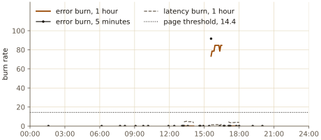

# Set alerts on the assistant's metrics

By the end of this chapter you can set two alerts on a service's metrics, test each one on a normal day and on an incident day, and say what each one misses. On the incident day, lookups to the contacts team's server start timing out at 13:00 UTC. The {{out:burn-rate-by-window:inc-contacts-timeout, messages in the hour to that tick}} messages in the hour to 13:15 all got a reply, although both attempts of each lookup timed out. Beside that, the model's rate limit at 15:30 left {{out:burn-rate-by-window:inc-rate-limit, messages with no reply in that hour}} of {{out:burn-rate-by-window:inc-rate-limit, messages in the hour to that tick}} messages in its hour with no reply. Which of those numbers would wake someone, and would the same number wake someone on a normal day? The faults on the incident day were injected, at windows the case sets, so nothing below is a record of an outage or a measure of any real service.

The assistant is Ambrewick's back end, and it records its own metrics as it runs. An alert can read those metrics without reading a single span. A metric is cheap to keep for every minute of a day, because it holds a few numbers for each attribute set ([chapter 6](#totals-from-metrics-not-spans) defines the form) and not one record for each message. That trade has a cost, which the chapter measures as it goes: a metric can say how many messages failed, but not which ones, and not why.

## The metrics the assistant exports {#metrics-the-assistant-exports}

A trace answers what happened to one message. An alert needs a different kind of record: a number for each minute of the day that moves when many messages move. [Chapter 6](#totals-from-metrics-not-spans) defines the metric, counter and histogram that this chapter uses, and reads the token totals from them. This section sets out which instruments the assistant records and what each one counts.

The assistant has a meter, and the meter records each operation as the operation ends. There are three duration histograms, one for each kind of operation. A message is one `invoke_agent` operation, so `gen_ai.invoke_agent.duration` holds one point for each message. A model call is one `chat` operation, and `gen_ai.client.inference.duration` holds one point for each call attempt. A tool attempt is one `execute_tool` operation, and `gen_ai.execute_tool.duration` holds one point for each. The names and units come from the [GenAI conventions' metrics page](https://raw.githubusercontent.com/open-telemetry/semantic-conventions-genai/v0.1.0/docs/gen-ai/gen-ai-metrics.md), at version {{out:bucket-edges-hide-tail:GenAI conventions version}}. The model-call and tool histograms are defined on the [client inference](https://raw.githubusercontent.com/open-telemetry/semantic-conventions-genai/v0.1.0/docs/gen-ai/client-inference.md) and [execute tool](https://raw.githubusercontent.com/open-telemetry/semantic-conventions-genai/v0.1.0/docs/gen-ai/execute-tool.md) pages that the same version publishes. Each duration histogram takes the unit of seconds, and the conventions ask that a failed operation set `error.type`. A message that got no reply therefore carries `error.type` on its point in the message histogram, and the alert counts on that attribute.

The meter also records each model call's tokens, in the counters and per-call histograms that chapter 6 reads. This chapter's alert does not use them, but the same meter writes them, so the export below includes them.

The meter is live. The alert reads it while the day runs, and each point reaches the meter when its operation ends. Each example in this chapter reads the meter in the same process that made the measurements. A production alert reads the same metrics once they leave the process, through whatever pipeline carries them, and that pipeline is outside this book.

Baseline day 1 is a normal day with no injected fault, so it is the right day to check that the meter agrees with the spans. The replay runs the day with the meter attached, and the export is then read back and set beside the spans' own counts.

[Example: assistant-metrics-export](../examples/assistant-metrics-export.py)

The sentence to keep is that the export and the spans agree. The counter for input tokens totals {{out:assistant-metrics-export:input tokens, counter total}} tokens, and the model calls' spans add up to the same {{out:assistant-metrics-export:input tokens, summed over chat spans}}. The message histogram holds one point for each message the day sent, {{out:assistant-metrics-export:message durations, histogram count}} in all, and the example's assertions check that count against the spans. The histogram holds {{out:assistant-metrics-export:series, gen_ai.invoke_agent.duration}} series on this day, one attribute set for a normal message. The next section explains why that number is the one to watch.

**Working rule:** Take an alert's counts from the meter, which records each operation as it ends. Assert once, in a test, that the meter's sums equal the spans' sums, and after that query the metric every time the alert runs.

## Cardinality {#cardinality}

A metric is stored and queried one series at a time. Every distinct combination of attribute values opens a new series, and a dashboard draws one line for each. An attribute that takes a few values adds a few lines. An attribute that takes a new value for every user adds a line for every user, and that is the case the rest of this section examines.

A metric's **cardinality** is the number of distinct attribute combinations it is recorded with, each a series to store.

The meter keeps five attributes on each point, and no others: the error type, the agent's name, the operation's name, the [prompt version](#release-markers-in-the-spans) and the model's name. The conventions' registry lists these as the metric attributes, and the table below calls them the registry's attributes. So the live meter gives one series on a normal day, as [the previous section](#metrics-the-assistant-exports) printed. The two attributes an operator most often wants, the route and the user, are not on the meter's points. Adding each of them to the message histogram, from the spans of the same messages, shows what each would cost.

[Example: cardinality-of-attributes](../examples/cardinality-of-attributes.py)

The same {{out:cardinality-of-attributes:messages}} messages come from {{out:cardinality-of-attributes:distinct users}} distinct users, and they fall into {{out:cardinality-of-attributes:distinct routes}} routes. The message histogram's series, for each set of attributes, are these.

| Attributes on the message histogram | Series |
| --- | --- |
| The registry's attributes | {{out:cardinality-of-attributes:series, registry attributes}} |
| The registry's attributes and the route | {{out:cardinality-of-attributes:series, registry attributes and route}} |
| The registry's attributes and the user ID | {{out:cardinality-of-attributes:series, registry attributes and user ID}} |

A route adds a fixed, small number of lines, one for each of the {{out:cardinality-of-attributes:distinct routes}} values the book uses. The user adds a line for each person who sent a message. The count grows with the users, and on a service with more of them it passes the SDK's limit, which the next paragraph describes.

The software has a limit as well. The OpenTelemetry metrics SDK stops at a default of 2,000 series for each metric stream in one collection cycle, and any attribute set past that limit falls into a single overflow series ([Metrics SDK, v1.45.0](https://raw.githubusercontent.com/open-telemetry/opentelemetry-specification/v1.45.0/specification/metrics/sdk.md)). The overflow series keeps the total right and hides the detail, so an operator who sees it has lost the lines that would have answered the question.

For that reason the assistant's metric takes no user ID, and this book never adds one. A user's messages are answered in traces, where one message is one record and its user is one attribute among many. A question about one user's latency is a question for a trace. The alert answers the question about the whole assistant's service.

**Working rule:** Label a metric only with values from a set you can list before launch. Count the series with each candidate attribute on a day of real traffic, and reject any attribute whose count grows with the users.

## Service-level objectives {#service-level-objectives}

An alert that says too many messages failed needs a line to measure them against, and a pace at which failing is still acceptable. An objective alone pages no one, so an alert measures how fast the failures use up the share that the objective leaves.

An **objective** is the share of messages that must succeed, or finish within a time, over a period; the **error budget** is the share it lets fail; the **burn rate** is how fast failures spend it, where 1 spends it exactly by the period's end.

The assistant has two objectives. The first is for failed messages. Over 30 days, 99% of messages must get a reply, which leaves an error budget of 1.0%; the period sets the arithmetic and forecasts no traffic. A message fails, for the objective, when its user got no reply; a retry that recovered is not a failure. That is narrower than [chapter 8's error](#how-a-span-records-failure). Under the span rule, a message whose first model request was refused and whose second request got a reply has an error, and so does a message whose lookup timed out on both attempts and whose model replied anyway. This objective counts neither, because the user got a reply in both cases. A [fallback reply](#where-the-time-went-in-twenty-messages) is a reply too, so the objective does not count it either. Whether a fallback reply went to the right scenario is a question for [chapter 8's wrong-route check](#wrong-routes-against-labels).

The second objective is for latency: over 30 days, 95% of messages must finish within 20 seconds, a line set above the slowest messages of a normal day, which leaves a latency budget of 5.0%. The number comes from the tail that [chapter 7](#tail-percentiles-with-intervals) measured on the recordings that [chapter 1](#replay-and-the-virtual-clock) introduces, so every time here is a recorded time on that replay's virtual clock. On baseline day 1 the 95th percentile (p95, by nearest rank) of message times is {{out:slo-and-budget:p95 of message times}}, over {{out:slo-and-budget:p95 of message times, nearest rank, n}}, which sits under the 20-second objective. The conventions advise edges for the `invoke_agent` duration histogram, as a SHOULD, from 0.1 to 86,400 s, which puts 12.8 and 25.6 either side of 20 and no edge at 20. The assistant's meter keeps its own edges, 0.5 to 60 s, set by a view, so the 20-second objective sits on one and the count within it is exact. [Chapter 7](#histogram-buckets-and-what-they-hide) shows what an estimate between two edges can do to a tail.

Baseline day 1 shows what the two objectives leave on a normal day.

[Example: slo-and-budget](../examples/slo-and-budget.py)

Both objectives hold on the normal day, and the code asserts it. Of the day's messages, {{out:slo-and-budget:messages with no reply}} got no reply, and {{out:slo-and-budget:messages over 20 s}} ran over 20 seconds.

Over the whole day the error burn is {{out:slo-and-budget:error budget spent over the day, burn}}, and the latency burn is {{out:slo-and-budget:latency budget spent over the day, burn}}. Both sit below 1, which is the pace the objective allows. Those are the burns an alert would read on a quiet day, and the next sections use the same two objectives.

**Working rule:** Set each objective from the numbers of a normal day, and check that the normal day meets it before any alert reads it. Print the objective's error rule beside its count, so a reader can tell it from chapter 8's span rule.

## Burn rate {#burn-rate}

A burn rate is a speed, not a count. Fourteen failures mean little until you know how many messages they came from and how large the [error budget](#service-level-objectives) is. For a window, the burn rate is the window's failed share of messages divided by the error budget. The failed share is a count over a count, so the burn is one more division, and it is a number that can be compared across windows of different sizes.

The windows in this section are on virtual time. The one-hour window and the five-minute window are read at each five-minute tick of the day, and each window's count is the difference between two cumulative reads of the same histogram. A histogram only grows, so a window's messages are what the histogram added between the two reads. The example reads the meter after each message and adds the reads up for each tick. That is how a dashboard reads a rate from a counter that only grows while the process runs.

Run over the incident day's three injected windows, the example below treats each window as one fault: the contacts server's timeouts, the model's rate limit, and the contacts server's error replies. For each window it prints the messages in the hour up to the first tick after the window, how many of them got no reply, and the burns over the hour and over five minutes. The burns are the highest from the window to five minutes after it.

[Example: burn-rate-by-window](../examples/burn-rate-by-window.py)

The tool attempts in those hours come from the meter's own tool histogram, `gen_ai.execute_tool.duration`, which the next example reads after each message in the same way.

[Example: tool-attempts-by-window](../examples/tool-attempts-by-window.py)

The table counts each window at the first tick after it, and its burns are the highest from the window to five minutes after it. The counts and the burns come from different ticks, so one row divided by another does not give the burn.

| Measure | Contacts timeout | Model rate limit | Contacts error replies |
| --- | --- | --- | --- |
| Window, UTC | {{out:burn-rate-by-window:inc-contacts-timeout, window}} | {{out:burn-rate-by-window:inc-rate-limit, window}} | {{out:burn-rate-by-window:inc-mcp-error, window}} |
| Messages in the hour to the first tick after | {{out:burn-rate-by-window:inc-contacts-timeout, messages in the hour to that tick}} | {{out:burn-rate-by-window:inc-rate-limit, messages in the hour to that tick}} | {{out:burn-rate-by-window:inc-mcp-error, messages in the hour to that tick}} |
| Of those, messages with no reply | {{out:burn-rate-by-window:inc-contacts-timeout, messages with no reply in that hour}} | {{out:burn-rate-by-window:inc-rate-limit, messages with no reply in that hour}} | {{out:burn-rate-by-window:inc-mcp-error, messages with no reply in that hour}} |
| Tool attempts in that hour | {{out:tool-attempts-by-window:inc-contacts-timeout, tool attempts in the hour to that tick}} | {{out:tool-attempts-by-window:inc-rate-limit, tool attempts in the hour to that tick}} | {{out:tool-attempts-by-window:inc-mcp-error, tool attempts in the hour to that tick}} |
| Of those, attempts with `error.type` | {{out:tool-attempts-by-window:inc-contacts-timeout, tool attempts with error.type in that hour}} | {{out:tool-attempts-by-window:inc-rate-limit, tool attempts with error.type in that hour}} | {{out:tool-attempts-by-window:inc-mcp-error, tool attempts with error.type in that hour}} |
| Highest error burn over 1 hour | {{out:burn-rate-by-window:inc-contacts-timeout, error burn, 1 hour, highest from the window to 5 minutes after it}} | {{out:burn-rate-by-window:inc-rate-limit, error burn, 1 hour, highest from the window to 5 minutes after it}} | {{out:burn-rate-by-window:inc-mcp-error, error burn, 1 hour, highest from the window to 5 minutes after it}} |
| Highest error burn over 5 minutes | {{out:burn-rate-by-window:inc-contacts-timeout, error burn, 5 minutes, highest from the window to 5 minutes after it}} | {{out:burn-rate-by-window:inc-rate-limit, error burn, 5 minutes, highest from the window to 5 minutes after it}} | {{out:burn-rate-by-window:inc-mcp-error, error burn, 5 minutes, highest from the window to 5 minutes after it}} |
| Messages over 20 s in the hour | {{out:burn-rate-by-window:inc-contacts-timeout, messages over 20 s in that hour}} | {{out:burn-rate-by-window:inc-rate-limit, messages over 20 s in that hour}} | {{out:burn-rate-by-window:inc-mcp-error, messages over 20 s in that hour}} |
| Highest latency burn over 1 hour | {{out:burn-rate-by-window:inc-contacts-timeout, latency burn, 1 hour, highest from the window to 5 minutes after it}} | {{out:burn-rate-by-window:inc-rate-limit, latency burn, 1 hour, highest from the window to 5 minutes after it}} | {{out:burn-rate-by-window:inc-mcp-error, latency burn, 1 hour, highest from the window to 5 minutes after it}} |

Only the rate-limit window spends the error budget fast. Its hour holds {{out:burn-rate-by-window:inc-rate-limit, messages with no reply in that hour}} messages with no reply, and its error burn is {{out:burn-rate-by-window:inc-rate-limit, error burn, 1 hour, highest from the window to 5 minutes after it}} over the hour and {{out:burn-rate-by-window:inc-rate-limit, error burn, 5 minutes, highest from the window to 5 minutes after it}} over five minutes. The injected rate limit refused those requests, and the refusals outlasted the retry backoff, so those messages ended with no reply.

The other two windows spend no error budget at all, because every message in them got a reply. Their latency burns, in the row for the highest latency burn over 1 hour, are well below 14.4, the burn the [next section](#an-alert-that-stays-quiet) pages at, and they measure slow messages, not failed ones.

The arithmetic gives the scale. A burn of 14.4 would spend the whole 30-day budget in 50 hours, since 720 hours divided by 14.4 is 50. At that pace one hour spends {{out:slo-and-budget:share of the 30-day budget a 1-hour page at burn 14.4 spends}} of the month's budget, and the page threshold in the next section is 14.4 for that reason.

**Working rule:** Compute each window's burn from the counts inside that window, and print the count beside each burn. A reader who sees 0.0 needs to know whether it means no failures among many messages, or no messages at all.

## One page on the incident day, none on a quiet one {#an-alert-that-stays-quiet}

A burn-rate alert on one window is a poor alert. A long window fires only after the spend has piled up, and it keeps firing for as long as the long window holds the failures. A short window fires on a brief spike, and it clears as soon as the spike ends. The *Site Reliability Workbook* (O'Reilly, 2018) pairs the two in its chapter 5, "Alerting on SLOs", and its Table 5-8 gives a page at a burn of 14.4 over one hour, with a five-minute window for the short check ([the workbook](https://sre.google/workbook/alerting-on-slos/)). The table gives each burn by the share of budget it spends and the window alone, so 14.4 over an hour spends 2% of a 30-day budget. That holds for a 99% objective and for a 99.9% objective alike. Only the failed share that trips it changes, to 14.4% of messages here. The workbook's traffic is not this book's, so its 14.4 is a starting point here and not a measurement the book has made.

The workbook's method pairs slower windows as well: a page at burn 6 over 6 hours with a 30-minute short window, which spends 5% of the budget, and a ticket at burn 1 over 3 days with a 6-hour short window, which spends 10%. Those catch a slow, sustained burn that a one-hour pair misses. One day of traffic cannot test them, which is why this chapter sets only the 1-hour pair.

The book's alert pages when the error burn is at least 14.4 over the hour and at least 14.4 over the last five minutes, and when the hour holds at least 10 messages. The last condition is the book's own. With few messages in an hour, one failure moves the burn a long way, so an hour below the minimum cannot page. The long window makes the page need a sustained spend, the short window lets the page clear once the spend stops, and the minimum keeps both readings meaningful. The workbook has a section for traffic this thin, "Low-Traffic Services and Error Budget Alerting", whose own example is 10 requests an hour. It offers three options: generate artificial traffic, combine small services for monitoring, or change the product. The book's minimum is none of the three. In production we'd take the second: a service this small shares its objective with a larger one before anyone relies on its page.

Next, the alert runs over the incident day at every five-minute tick, for the [error objective](#service-level-objectives) and for the latency objective.

[Example: alert-on-incident-day](../examples/alert-on-incident-day.py)

The alert pages once on the incident day. The first firing is at {{out:alert-on-incident-day:first tick the error page fires}} UTC, and the page clears at {{out:alert-on-incident-day:first tick the error page is clear again}}. At the first firing the hour held {{out:alert-on-incident-day:messages in that hour, with no reply}} messages with no reply. Across the day the error page fires at {{out:alert-on-incident-day:ticks where the error page fires}} ticks, and the latency page never fires, as the example asserts.

The page fires for the rate-limit window and for nothing else. The timeout window never pages on this objective. It is the window the case starts at 13:00 UTC, and the error page fires at {{out:alert-on-incident-day:inc-contacts-timeout, ticks where the error page fires}} ticks around it. Each lookup in that window was retried ({{out:retries-under-incident:inc-contacts-timeout (injected), retries}} retries), every attempt timed out ({{out:retries-under-incident:inc-contacts-timeout (injected), attempts that time out}} attempts), and no retry recovered. The model then wrote its reply from the tool's timed-out result. The two messages whose lookups timed out got replies that blamed the name, though the lookup never answered. Every message got a reply, so the error objective counts none.

The messages in that window go slow instead. Its latency burn reaches {{out:burn-rate-by-window:inc-contacts-timeout, latency burn, 1 hour, highest from the window to 5 minutes after it}}, and the highest latency burn over the whole day, with the minimum met, is {{out:alert-on-incident-day:highest latency burn over an hour, with the minimum met}}. A latency page at 14.4 would need 72% of an hour's messages over 20 seconds, which is 14.4 times the 5.0% budget, and this day never came near that share. A fault the model answers around does not reach the error objective, and the latency objective would need a far larger share of slow messages before it paged. The fault shows in the tool's ERROR attempts, which the table's tool rows count in `gen_ai.execute_tool.duration`.

The contacts server's error replies, the third window, behave the same way on this objective, because the tool's error result went to the model, which answered with no retry ({{out:retries-under-incident:inc-mcp-error (injected), retries}} retries). Its messages got replies, and the error page fires at {{out:alert-on-incident-day:inc-mcp-error, ticks where the error page fires}} ticks around that window.

[Example: figure-burn-rate-incident-day](../examples/figure-burn-rate-incident-day.py)

{{fig:burn-rate-incident-day}} draws the incident day as an on-call dashboard would: one spike crosses the page threshold, in the rate-limit window, and nothing else comes near it. The error burn over 5 minutes peaks in that window and falls back within minutes, which is why the page clears. The error burn over 1 hour stays above the threshold for longer, because the refusals stay inside its hour after the five-minute burn has fallen. The latency burn over 1 hour never reaches the page threshold, {{out:figure-burn-rate-incident-day:page threshold}}. The one-hour lines have gaps where their hour holds fewer than the minimum, at {{out:figure-burn-rate-incident-day:gaps, one-hour burn at ticks under the minimum}} ticks of the day. The five-minute line has gaps where its window holds no message.

**Working rule:** Page only when a long window and a short window both reach the threshold, use the short window to clear the page, and let neither window page on an hour with fewer messages than the minimum.

## Test the same alert on a quiet day {#quiet-day-on-baseline-day-two}

A quiet day is the other half of the test. Baseline day 2 has no injected fault, and the same alert should not page on it at any tick, for either objective.

[Example: alert-quiet-on-baseline-day-two](../examples/alert-quiet-on-baseline-day-two.py)

Baseline day 2 has {{out:alert-quiet-on-baseline-day-two:messages, baseline day 2}} messages, and {{out:alert-quiet-on-baseline-day-two:messages with no reply}} of them got no reply. Its highest error burn is {{out:alert-quiet-on-baseline-day-two:highest error burn over an hour}} over the hour and {{out:alert-quiet-on-baseline-day-two:highest error burn over 5 minutes}} over five minutes.

Its highest latency burn, with the minimum met, is {{out:alert-quiet-on-baseline-day-two:highest latency burn over an hour, with the minimum met}}, well short of 14.4. The error page fires at {{out:alert-quiet-on-baseline-day-two:ticks where the error page fires}} ticks, and the code asserts that the page is quiet at every one.

The quiet comes from the messages, not from the minimum. On this day's traffic only {{out:alert-quiet-on-baseline-day-two:ticks where the hour holds the minimum}} ticks hold the minimum of messages in the hour, and those are the only ticks at which the error page could read a full hour at all. An hour under the minimum cannot page whatever it holds: nine failures out of nine stay silent. The minimum guards against a single failure in a thin hour, and on a thin day it decides most of the verdicts. Whether the alert is sound on a busier service is a question this book's traffic cannot answer.

**Working rule:** Test an alert on two days, one that must page and one that must not, and print the ticks it could not read beside the verdicts it gave.

## Where a burn-rate alert goes blind {#alerts-on-metrics-in-production}

An objective that counts what users got misses every fault the model answers around. In the [timeout window](#an-alert-that-stays-quiet), the model replied without the contact, and the page did not fire. A second objective is the usual answer: one on tool attempts, or one on the latency of the slowest messages by route. The examples in this chapter ship neither. A tool-level page would also read few calls on this traffic, since the meter counts every tool attempt, and baseline day 1 has only {{out:assistant-metrics-export:tool attempts, execute_tool operations}} of them in a whole day.

The alert sees a message only when the message ends. A message that waits on a retry enters the hour's count late, and its failure, if it has one, reaches the page late as well. An operator who expects the page to fire the moment a fault starts will be disappointed by every message that was still running at the tick.

Real faults carry no label. The windows in this chapter are the case's, so each count can be matched to a window afterwards. A production alert has no such record, and [chapter 8's production section](#find-the-failure-in-production) makes the same point about failure rates. Keep the incident's start and end next to the counts when you review them, and do not let a retrospective match stand as the measure of the alert.

The failed-message rate in this chapter and chapter 8's error rate disagree on purpose. The span rule in chapter 8 counts a recovered message as an error, and the objective here does not. Print both, each with the rule that produced it. Chapter 10's gate counts errors by span status, so chapter 8's error rate is the stricter one, and a release that looks bad to the gate may look fine to the objective. Neither number is wrong, because they answer different questions. A dashboard that shows one under the other's name will mislead.

Every new attribute on a metric multiplies its storage and its query time. Before you add one, count its series on a day of real traffic, as the cardinality example does, and keep the count with the change. The overflow series the SDK writes past its limit is not a fallback that keeps the metric useful. It is a sign that the attribute was the wrong one.

**Working rule:** Recompute the burn on your own traffic before the first page, and set the minimum from the messages an hour actually holds on your service.

## What this chapter decided {#alerts-on-metrics-decisions}

The chapter's lesson is that an objective on what users got pages on the faults users feel and misses the faults the model answers around, so an alert on the assistant's metrics needs a second number to see those.

- The error objective counts messages with no reply, read from the duration histogram. Span errors stay in the traces, under chapter 8's definition, and chapter 10's gate reads them.
- The latency objective is 95% of messages within 20 seconds, set from baseline day 1's tail and read at a bucket's edge.
- The page fires at a burn of 14.4 over one hour and over five minutes, with at least 10 messages in the hour. The pair and the starting number come from the workbook, and the minimum is the book's.
- The metrics carry the registry's attributes only. The route and the user are counted from the spans, to show what they would cost, and they stay out of the meter.
- No tool-level or per-route objective is set in this chapter, so the timeout window stays unpaged on this objective.
- An alert on what users got pages on the faults users feel, and it misses a fault the model answered around. A second objective, on the attempts or on the tail, is what would catch that fault. [Chapter 10's gate](#the-ci-gate) compares releases on message time, input tokens, cost, error rate and route accuracy, on the same messages, and it reads neither the attempts nor the tail.
