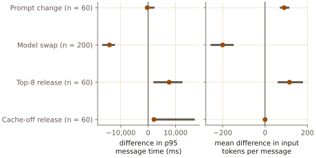

# Catch a regression in the traces

By the end of this chapter you can say whether a release moved a number, by how much, and whether that move is bigger than the day's noise. You can also write the rule that stops a release from shipping when it moves too far. Four changes to the assistant wait to ship, and each claims to change nothing that matters. One adds six routing examples to the route prompt. One swaps the 4B model, Qwen3-4B-Instruct-2507, for the smaller Qwen3-0.6B. One retrieves more articles for the routes that retrieve, and one turns the prompt cache off. Which of them moved latency, tokens, cost, errors or route accuracy? And would a gate catch the ones that did, without stopping a normal day?

The question has two parts, and the second is the harder one. A release can move a number on the messages it was measured on and still sit inside what an ordinary day would show. So the comparison has to run both releases on the same messages, and it has to say how far the difference could move. The chapter builds a comparison of the two releases on the same messages, and turns it into a gate with fixed limits. It marks each trace with its release so a query can split them, pairs the releases message by message, and puts an interval beside every difference.

## Release markers in the spans {#release-markers-in-the-spans}

A comparison can only split traces by release if each trace says which release made it. Chapter 2 put the markers in place. The resource carries `service.version`, which names the release, and each inference span carries `gen_ai.prompt.version`, which names the prompt it was sent with ([who made the span](#who-made-the-span), and [the requirement levels](#requirement-levels), where the prompt pair appears). A release is marked by `service.version` on the resource and `gen_ai.prompt.version` on the inference span, so a query can split traces by release.

The marker does more than label. Without it, a query over a week of traces would mix the releases into one average, and no release would show its own movement. With it, the same query returns one row per release. Below, the same 60 messages are replayed under the baseline and under each of the four changes, and every span of the five replays goes into one file. Each replay keeps its own markers, and the span IDs come from one sequence, so no two replays share an ID.

[Example: release-markers-query](../examples/release-markers-query.py)

The query groups the inference spans by their two markers and counts them, and it counts the traces each release produced. Every release answers the same 60 messages, which is why the trace counts match. The run asserts that the five marker pairs are exactly the pairs the release table gives, and that every release answered every message, so a missing marker fails the run rather than thinning a row.

Each release produced {{out:release-markers-query:service.version 1.0.0, messages (traces)}} traces, one per message. The table shows what the markers separate, and the answer calls are the count to check: the model swap is the row that differs from its neighbours.

| Release | Prompt version | Answer calls |
| --- | --- | --- |
| Baseline | p1 | {{out:release-markers-query:service.version 1.0.0, gen_ai.prompt.version p1, ambrewick.answer}} |
| Prompt change | p2 | {{out:release-markers-query:service.version 1.1.0, gen_ai.prompt.version p2, ambrewick.answer}} |
| Model swap | p1 | {{out:release-markers-query:service.version 1.2.0, gen_ai.prompt.version p1, ambrewick.answer}} |
| Top-8 release | p1 | {{out:release-markers-query:service.version 1.3.0, gen_ai.prompt.version p1, ambrewick.answer}} |
| Cache-off release | p1 | {{out:release-markers-query:service.version 1.4.0, gen_ai.prompt.version p1, ambrewick.answer}} |

Under the model swap there are fewer answer calls than under the baseline, on the same 60 messages. An answer call is the model call that writes the reply, and a message routed to fallback makes none. The model swap makes fewer of them because it routes more messages to fallback. [The CI gate](#the-ci-gate) counts the routes that changed later in this chapter. Without the markers the five rows would collapse into one, and nothing in the table would say which release made which call.

**Working rule:** Mark every trace with its release and its prompt version, and split each query by both before you read a number.

## Paired comparison on messages {#paired-comparison-on-messages}

Two releases measured on different messages differ for two reasons: the release, and the messages. A day's messages vary a great deal. Some are long requests, some route to the fallback reply, and some wait on a slow tool. Run both releases on the same messages and the second reason drops out of each difference, because each message serves as its own control. A paired comparison runs two releases on the same messages and summarises, for each message, the release's value minus the baseline's.

The method is the one that Evaluating LLM Applications calls a [paired comparison](https://rollingedition.com/concepts/artificial-intelligence/paired-comparison). That book subtracts verdicts; this one subtracts the values it reads from traces. Every latency here comes from the recording machine, a 4-vCPU Intel Xeon at 2.10 GHz, as chapter 1 describes, and the replays run on the virtual clock. Message time is the sum of the recorded durations of a message's model calls and contacts-tool calls, which is the number chapter 7 counts. The gaps the recorder left between calls are not in it.

Each measure has its own statistic. For message time, input tokens, cost, errors and [route accuracy](#wrong-routes-against-labels), the statistic is the mean of the per-message differences. The percentile is different, and the text says which statistic each difference is. For the 95th percentile, the book takes the difference of the two p95s, and it resamples the messages jointly: each resample draws the same messages for both releases and takes the 95th percentile on each side. The interval around every difference is chapter 7's percentile bootstrap, run on the messages and resampled as pairs. For a mean, the statistic is the mean of the per-message differences, and for the p95 it is the difference of the two p95s. The unit resampled is the message and never the span. Chapter 7 built that bootstrap for one release's percentile, and here the same resampling runs on pairs.

Input tokens here are the recorded counts, and [chapter 6](#three-token-counts) says where each count comes from.

Next, the example sets each change beside the baseline on the messages that change recorded.

[Example: paired-latency-and-tokens](../examples/paired-latency-and-tokens.py)

Pairing narrows the prompt change's token interval from {{out:paired-latency-and-tokens:r1, input tokens, interval width if unpaired}} tokens wide to {{out:paired-latency-and-tokens:r1, input tokens, interval width paired}}. On its 60 paired messages, input tokens per message rise by {{out:paired-latency-and-tokens:r1, input tokens per message, mean difference}}, and that rise is the change the gate has to see.

Its mean message time rises by {{out:paired-latency-and-tokens:r1, message time, mean difference}}, and its 95th percentile moves the other way, by {{out:paired-latency-and-tokens:r1, message time, p95 difference}}. The mean and the p95 disagree in sign, and the p95's interval runs from below zero to far above it. On 60 messages the tail cannot say which way it moved. The p95 is printed here and not gated, and [what the gate misses](#what-the-gate-misses) says why.

Cost per 1,000 messages rises by {{out:paired-latency-and-tokens:r1, cost per 1,000 messages, mean difference}}, priced at the book's price table, version `book-2026-11-02`, as [chapter 6](#the-price-table) sets out. The error rate does not move: {{out:paired-latency-and-tokens:r1, error rate, mean difference}}. The route accuracy difference is {{out:paired-latency-and-tokens:r1, route accuracy, mean difference}}. Its interval starts at zero, so this release has not been shown to change routing.

The model swap is the line with the most movement, and its comparison carries a caveat that applies to every line in it. The 0.6B's prompt carries `/no_think` as well as the smaller model, so the swap is not a pure model swap, as [prompt versions](#prompt-versions) explains. Its prompt version still reads p1. Mean message time changes by {{out:paired-latency-and-tokens:r2, message time, mean difference}}. Route accuracy changes by {{out:paired-latency-and-tokens:r2, route accuracy, mean difference}}, and that change is the model and the suffix together. The swap ran all {{out:paired-latency-and-tokens:r2, messages (paired with r0)}} messages of the baseline day. Its cost line rests on the 0.6B's row in the price table. The book wrote that row, and it has no source. The cost difference of {{out:paired-latency-and-tokens:r2, cost per 1,000 messages, mean difference}} is therefore only as firm as that assumed rate.

The top-8 release retrieves more articles on the three routes that retrieve. [Chapter 7](#retrieved-context-against-prefill) measured the prefill that comes with the extra context. Here its input tokens rise by {{out:paired-latency-and-tokens:r3, input tokens per message, mean difference}}, and its mean message time by {{out:paired-latency-and-tokens:r3, message time, mean difference}}.

The cache-off release is the one that should not move input tokens, and it does not. Its input total differs by {{out:paired-latency-and-tokens:r4, input tokens per message, mean difference}}, because the prompt the model reads is the same. Its cost rises by {{out:paired-latency-and-tokens:r4, cost per 1,000 messages, mean difference}}, and its mean message time by {{out:paired-latency-and-tokens:r4, message time, mean difference}}. The printed lines give the input total and the cost, not the cached count, so the cost line is the evidence here. [Chapter 6](#cached-prompt-tokens) explains how the cached count is derived.

{{fig:paired-differences}} draws the two differences for each release, the p95 message time on the left and input tokens per message on the right, each with its interval. The zero line is the reference. The prompt change's p95 interval crosses it, which is the tail's uncertainty in one picture. The token intervals for the prompt change, the model swap and the top-8 release lie clear of zero, and the cache-off release's token interval sits on it, as its input total says.

[Example: figure-paired-differences](../examples/figure-paired-differences.py)

**Working rule:** Subtract the baseline's value for each message before you summarise. Resample the messages jointly for a percentile, and print each difference with its count and its interval.

## Prompt versions {#prompt-versions}

The releases differ in their prompts, and one of them differs in its model as well, so this section says what changed in each prompt before the gate judges the numbers. The baseline's prompt is `p1`. The prompt change is `p2`, which adds six routing examples to the route prompt. The six examples add {{out:gate-on-prompt-release:r1 against r0, route call input tokens per call, mean difference}} tokens to every route call, and every message makes one. The rest of the prompt change's rise, {{out:gate-on-prompt-release:r1 against r0, input tokens per message, answer calls' share}} tokens per message, and the width of its paired interval come from the {{out:gate-on-prompt-release:r1 against r0, messages whose route changed}} messages whose route changed, as [the paired comparison](#paired-comparison-on-messages) shows. The markers confirm that both prompts make one route call per message, on the same 60 messages. The top-8 release keeps `p1`'s template, and only its retrieved context grows.

The model swap keeps `p1` as its prompt version, and this is the point to read carefully. Its prompt is not the baseline's, because it carries `/no_think`. Qwen3-0.6B is hybrid-thinking, and its [model card at the pinned commit](https://huggingface.co/Qwen/Qwen3-0.6B/blob/c1899de289a04d12100db370d81485cdf75e47ca/README.md) says that with thinking enabled the model always writes a `<think>...</think>` block, whose content may be empty when thinking is turned off. The recording script adds the suffix to the prompts. We decided that the release carries it, and that its prompt version stays `p1`. The release marker cannot show the suffix, so a query that splits by prompt version would count the model swap as the baseline's prompt. Under the suffix, the recording's model replies open with an empty block in {{out:gate-on-model-swap:r2, model replies with an empty <think> block}} of their {{out:gate-on-model-swap:r2, model replies}}, and the assistant's parser drops that block from each reply. The pair still costs output tokens: on average, each route call's output grows by {{out:gate-on-model-swap:r2 against r0, route call output tokens per call, mean difference}} tokens. One answer reply writes its reasoning into its block instead, and the parser drops that as well.

That matters for the token comparison. The two models share one Qwen3 tokenizer. The book checked that on three texts, and the 4B and the 0.6B give identical token IDs for each, so their input counts compare directly. The check covers three texts, not every message, and the chapter claims no more than that. The model swap's token difference is therefore the smaller model and the suffix together. The model-swap gate prints the split: the suffix adds {{out:gate-on-model-swap:r2 against r0, input tokens per message, route calls' share}} tokens to each route call, and the answer calls change it by {{out:gate-on-model-swap:r2 against r0, input tokens per message, answer calls' share}} tokens per message, since the messages routed to fallback make no such call.

**Working rule:** Read a release's prompt version with the prompt's differences beside it. Say beside any model comparison whether the prompt changed as well.

## The CI gate {#the-ci-gate}

A comparison gives numbers, and a gate turns them into a decision. A regression gate is a check in CI that stops a release from merging when a number read from its traces has moved past its threshold, judged against its paired interval. A regression is a release's change that makes a trace-derived number worse than its limit allows, judged by the end of its interval nearest the limit. The limits are set below. The interval is the one [chapter 7](#tail-percentiles-with-intervals) builds for a number measured on a day's messages. [Evaluating LLM Applications](https://rollingedition.com/concepts/llm-evaluation/gate) shares that rule, a rule that stops a change from merging, and [Business Intelligence with Agents'](https://rollingedition.com/concepts/llm-evaluation/regression-gate) regression gate uses a different one. Evaluating LLM Applications also describes a [naive gate](https://rollingedition.com/concepts/llm-evaluation/naive-gate), which fails on the point estimate alone. This gate waits for the interval.

The gate has one job here: catch the prompt change without flagging the baseline's second day, with the same rules for both. The five rules are fixed in code, and the gate prints every line it judges. Message time, input tokens and cost may each rise by a tenth of the baseline's mean on the same messages, which is why the limits differ on 60 and 200 messages. The error rate may rise by two points, and route accuracy may fall by five points. Each rule reads the interval of the release's difference, and a rule flags a release when the end of that interval nearest the limit lies past the limit. For a rise, that is the lower end. For a fall in route accuracy, it is the upper end. So a flag means the release is worse than its limit, beyond its 95% interval. A release whose interval merely reaches past the limit is not flagged.

We set these limits, and the chapter applies them as printed rather than tuning them to these recordings. The relative limits scale with the baseline's mean. The error rate's baseline is zero, so a relative limit would leave it no room, and its limit is two points. Route accuracy is a share of messages, so it moves in points, and its limit is five. The rules read traces, never an answer's text. For route accuracy, the gate reads the route the reply names and checks it against the scenario table.

The error rule uses the definition [chapter 8](#how-a-span-records-failure) gives. A reply cut at its token cap, or a route reply that names no route, is not an error under that definition. Chapter 8 counts those as quality findings, and route accuracy already counts the second.

The gate has to pass a normal day, or a team would stop reading it. Gating baseline day 2 against day 1 shows whether it does, with the same rules and limits.

[Example: gate-on-baseline-day-two](../examples/gate-on-baseline-day-two.py)

The two days share {{out:gate-on-baseline-day-two:messages shared by the two days}} messages, so the intervals are unpaired. Message time rises by {{out:gate-on-baseline-day-two:baseline day 2 against day 1, message time, mean}}, and the lower end of that interval is far below the limit, so the rule does not flag. The other rules pass as well, and the verdict is {{out:gate-on-baseline-day-two:baseline day 2 against day 1, gate verdict}}.

Paired, the prompt change should fail on tokens; unpaired, the same 60 messages should pass. Both judgements run on the same messages, and the run asserts both results.

[Example: gate-on-prompt-release](../examples/gate-on-prompt-release.py)

The token rise clears its limit even at the low end of its interval: {{out:gate-on-prompt-release:r1 against r0, input tokens per message, low end of interval}} tokens against a limit of {{out:gate-on-prompt-release:r1 against r0, input tokens per message, limit}}. The rule flags, and the release's verdict is {{out:gate-on-prompt-release:r1 against r0, gate verdict}}. The flag belongs to the input tokens alone.

Message time rises by {{out:gate-on-prompt-release:r1 against r0, message time, mean}}, which is under its limit, and the nearer end of its interval is under it too. The upper end runs past the limit, but the rule reads the end nearer the limit, so the rule does not flag. Cost rises by {{out:gate-on-prompt-release:r1 against r0, cost per message, mean, per 1,000 messages}} per 1,000 messages. Its lower end is under its limit, so cost is not flagged either, though tokens rise on the same messages.

Judged as unrelated samples, the same 60 messages pass. The token rise is still {{out:gate-on-prompt-release:r1 against r0, unpaired, input tokens per message, mean}}, but its interval runs from below zero to above the limit, its nearer end is under the limit, and the verdict is {{out:gate-on-prompt-release:r1 against r0, unpaired, gate verdict}}. The interval widths in [the paired comparison](#paired-comparison-on-messages) are why. The shared messages hold the interval narrow enough to see the change through, and the unpaired interval is too wide to see it. The gate catches the change only because the messages are paired.

**Working rule:** Pair the releases whenever their messages overlap, and judge each rule on the end of its interval nearest the limit. Print every line, so a flag can be checked by eye.

## Gating the other changes {#gating-the-other-changes}

Gating the model swap on all 200 messages shows a different failure. Its amounts fall, which the rules pass, and its routes fall, which one rule catches.

[Example: gate-on-model-swap](../examples/gate-on-model-swap.py)

The amounts fall because the model swap leaves {{out:gate-on-model-swap:messages answered by r0 and not by r2}} messages without the answer call the baseline made. Those answer calls change the count by {{out:gate-on-model-swap:r2 against r0, input tokens per message, answer calls' share}} tokens per message. The suffix adds {{out:gate-on-model-swap:r2 against r0, input tokens per message, route calls' share}} tokens to each route call, and the two together make the fall. The rules for those amounts flag a rise, so a fall passes them, and the gate's pass on them follows from its route failure, not from a cheaper model.

Route accuracy changes by {{out:gate-on-model-swap:r2 against r0, route accuracy}}, and the upper end of its interval is past the limit, so that rule flags it and the release's verdict is {{out:gate-on-model-swap:r2 against r0, gate verdict}}. Choosing a smaller model is the subject of [Small Open Models](https://rollingedition.com/small-open-models/s/where-the-small-model-still-loses), which this chapter does not take up. The release is the 0.6B with `/no_think`, as [prompt versions](#prompt-versions) says, so the route change belongs to the model and the suffix together. The error rate does not move: {{out:gate-on-model-swap:r2 against r0, error rate}}, which matches the other releases in this chapter.

The route check counts a route as wrong when it differs from the scenario table, and it does not read the answer that follows. A right route with a wrong answer passes this rule.

The top-8 release and the cache-off release get the same gate on the same 60 paired messages, and the example runs both.

[Example: gate-on-retrieval-and-cache](../examples/gate-on-retrieval-and-cache.py)

Both releases fail. The top-8 release is caught on all three amounts, and its input tokens rise by {{out:gate-on-retrieval-and-cache:r3 against r0, input tokens per message, mean}} per message. The cache-off release is caught on time and cost alone, because its input stays the same, and its cost rises by {{out:gate-on-retrieval-and-cache:r4 against r0, cost per message, mean, per 1,000 messages}} per 1,000 messages.

| Comparison | Messages | Verdict | Rule flagged |
| --- | --- | --- | --- |
| Baseline day 2 against day 1, unpaired | {{out:gate-on-baseline-day-two:messages, baseline day 2}} | {{out:gate-on-baseline-day-two:baseline day 2 against day 1, gate verdict}} | None |
| Prompt change against baseline, paired | {{out:gate-on-prompt-release:messages (paired)}} | {{out:gate-on-prompt-release:r1 against r0, gate verdict}} | Input tokens |
| Prompt change against baseline, unpaired | {{out:gate-on-prompt-release:messages (paired)}} | {{out:gate-on-prompt-release:r1 against r0, unpaired, gate verdict}} | None |
| Model swap against baseline, paired | {{out:gate-on-model-swap:messages (paired)}} | {{out:gate-on-model-swap:r2 against r0, gate verdict}} | Route accuracy |
| Top-8 release against baseline, paired | {{out:gate-on-retrieval-and-cache:r3 against r0, messages (paired)}} | {{out:gate-on-retrieval-and-cache:r3 against r0, gate verdict}} | Message time, input tokens and cost |
| Cache-off release against baseline, paired | {{out:gate-on-retrieval-and-cache:r4 against r0, messages (paired)}} | {{out:gate-on-retrieval-and-cache:r4 against r0, gate verdict}} | Message time and cost |

Each of the four changes moved something the gate reads, and the gate flags each one: the prompt change through its tokens, the model swap through its routes, the top-8 release on all three amounts, and the cache-off release on time and cost. The normal day passes, and no release moved the error rate. That answers the question at the top of the chapter, with the rules the gate was given.

**Working rule:** Check each flagged rule against the amount it reads, and ask what in the release moved that amount.

## What the gate misses {#what-the-gate-misses}

A gate passes whatever it does not read. The five rules read message time, input tokens, cost, the error rate and route accuracy, and a release can change other things the gate never sees. Four of these matter in this chapter.

The first is quality. The gate reads traces, not answers. A release can route every message correctly, keep its tokens and its time, and still write worse replies, and this gate passes it. Judging a reply is a different job. Evaluating LLM Applications gives it a [code check](https://rollingedition.com/concepts/llm-evaluation/code-check), which reads a reply's text against the item's own reference answer. A regression in quality needs a check of that kind, run on the same messages with the same paired comparison, and this chapter does not run one. The book judges no answer's quality.

The second is the tail. The 95th percentile is printed and not gated. On the 60 paired messages the prompt change's p95 difference points down while its mean points up, and the p95's interval is much wider than the mean's, as [the paired comparison](#paired-comparison-on-messages) shows. The gate reads the mean because, on 60 messages, the mean's interval is the narrower of the two. A release whose tail grew could still pass this gate on its mean.

The third is the interval itself. A rule flags only when the end of the interval nearest the limit passes it, so a real rise can pass. The prompt change's message time is the example. Its mean sits under the limit, and its interval's upper end reaches past it. The gate cannot say whether that release moved time past its limit. It can only decline to flag it.

The fourth is the record. In production, two releases rarely meet the same messages, and comparing them on live traffic is the subject of Evaluating LLM Applications' [variants on traffic](https://rollingedition.com/evaluating-llm-applications/s/variants-on-traffic). Every release in this chapter is a replay of calls the book recorded, and a replay answers only the calls its recording holds. A change that sends different calls cannot be gated here, because nothing answers them. Two more gaps follow from the same place. The error rate of the prompt change changes by {{out:paired-latency-and-tokens:r1, error rate, mean difference}}, and the baseline's own count of ERROR spans on its replay is {{out:error-status-by-step:real ERROR spans, baseline day 1 (4B)}}, the status that [chapter 8](#how-a-span-records-failure) explains. The error rule is in the gate, but these recordings do not trip it, so the chapter cannot show it catch an error. The cost lines rest on the book's price table. Chapter 6 says that a self-hosted model is billed by its machine and not by its tokens, so the dollar figures compare token prices and do not compare bills.

**Working rule:** Name in each gate's report what it does not read, beside its verdict, so a pass is not taken for a clean release.

## The decisions this chapter made {#catch-a-regression-decisions}

- The prompt change is gated on its 60 paired messages, the model swap on all 200, the top-8 and cache-off releases on their 60, and the normal day on two unpaired days. The paired messages are the ones the baseline and the release share.
- We set the limits; the error rule is chapter 8's. The chapter applies them as printed and does not tune them to these recordings.
- The 95th percentile is printed and not gated, and the gate judges the mean of message time.
- The model swap's amounts are split into the suffix and the answers it lost, and its route accuracy is the model and the suffix together. Its cost rests on a price row with no source, and the chapter says so beside the cost line.
- The gate reads recorded calls, not live traffic, so every verdict here describes the recordings.

A difference means little without its interval, and the same messages are what keep the interval narrow enough to read. On 60 paired messages the prompt change's token difference is visible. The same 60 judged unpaired would hide it. That is why the chapter pairs every comparison it can, and why a reader who copies this gate should keep the pairing before the limits: the same limits, judged unpaired, pass the prompt change.

**Working rule:** Read a difference only with its interval beside it, on the same messages, and with the gate's blind spots printed beside its verdict.
