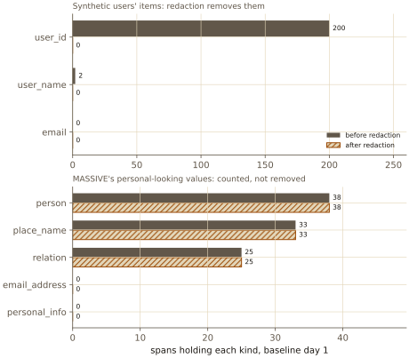

# Keep private data out of telemetry

By the end of this chapter you can keep personal data out of the assistant's telemetry by default, turn content capture on for a stated purpose and count what that leaks, and say which leaks redaction can remove and which it cannot reach. You'll also run the scan that counts what is left, and you'll see which counts are zero by assertion and which are only measured.

Ambrewick's traces are read by people who did not write the assistant. The on-call engineer opens a trace after an alert, and the contacts team opens the traces that its own lookups joined. Some of what those traces hold is personal. Every message's root span carries the user's ID whether or not anyone asked for content, and the engineer who chases one wrong route will want the prompt and the reply. Capturing those puts the user's name in the same spans, next to the people, places and relations that the requests mention. The contacts server adds a leak that no capture switch controls. The problem, in the case, is that the trace that explains a wrong route is also a copy of the conversation.

The users, the tools and the contacts are synthetic, and the requests are MASSIVE's. The users' names come from fixed lists, their addresses sit on the `.example` domain, and the case has no payment or phone numbers of its own. The requests keep the person, place and relation values that MASSIVE annotates. Those values are request text that the dataset's crowd workers wrote, and this book leaves them as written, labelled by their slots. The scanner reads each span's values and its captured text, counts each kind it looks for, one item for each match, and this chapter reports the count that redaction cannot remove. Most of the examples replay baseline day 1. Where the contacts server matters, they read the incident day from [chapter 9](#an-alert-that-stays-quiet).

## Capture off comes first {#capture-off-by-default}

The [content capture](#the-capture-switch) switch from chapter 3 is the primary defence in this chapter, and it comes first. With the switch unset the package records no prompt and no reply, so there is nothing for a later step to remove. Everything after this section is for the cases where someone has turned the switch on. A service that has not named a purpose for content keeps the switch at its default, and it reads the default of every package it loads, because one package's default is not another's.

One model call under each of the four modes shows what each mode writes, to the span and to the logs.

[Example: capture-modes](../examples/capture-modes.py)

With the switch unset, the content is in neither place: the span holds {{out:capture-modes:content attributes on the span, NO_CONTENT}} content attributes, and the package writes {{out:capture-modes:log records, NO_CONTENT}} log records. The span modes put the prompt and the reply on the span, and the event modes write a log record, as the next section describes. That pair is the whole case for the primary defence: the content is not in the telemetry, so nothing downstream can leak it.

Capture off does not mean that nothing leaves. The user's ID sits on every message's root span whichever mode is set, and the [leak example](#what-leaks-when-capture-is-on) asserts one such span for each message, whatever the capture setting. The ID is the user's own identifier, and a trace needs some identifier to answer which user a message came from, so it cannot be left out. It has to be replaced before it is stored, and [keyed user pseudonyms](#keyed-user-pseudonyms) show how.

No email address appears in any span of baseline day 1, with capture on or off. The assistant's policy tells the model never to repeat a contact's address in a reply, and no tool span carries its arguments, so an address has no route into a span. The scanner finds no address before [redaction](#redaction-as-defence-in-depth) or after it. The email kind reads zero because the design gives an address no route, and the scanner, which looks for every case address as written, confirms it.

Names behave differently. With capture off, the [leak example](#what-leaks-when-capture-is-on) asserts that no user name and no message text reaches a span. Names appear only when capture is on, which the next section measures.

**Working rule:** Keep content capture off in every service, and read the default of each loaded package before you deploy it. Turn capture on only for a purpose you can name, and only where a redactor runs on every span before the backend keeps it.

## What leaks when capture is on {#what-leaks-when-capture-is-on}

Suppose an engineer turns capture on to debug one wrong route. The reason is a good one, and what it costs is the same for every message that day. Each mode writes content to a different place. In `SPAN_ONLY` the prompt and the reply go into two span attributes, `gen_ai.input.messages` and `gen_ai.output.messages`, the names the registry gives them. The system text is folded into the input messages, so the instructions the model was given travel with the user's text. In `EVENT_ONLY` the same content goes onto a log record named `gen_ai.client.inference.operation.details`, and the span holds none of it. `SPAN_AND_EVENT` writes both. The logs SDK is still published under the private `opentelemetry.sdk._logs` at {{version:opentelemetry-sdk}}. A reader configures a `LoggerProvider` from it, and `InMemoryLogRecordExporter` is the class that reads records back. The package writes through the logs API, not that path. A second switch writes content as well. The upload hook writes messages to a store whenever it is on, with capture set or not, and [keeping content by reference](#keep-content-by-reference) shows what that does.

A personal-looking value is a person, place or relation name in a request's text, written by the dataset's crowd workers and labelled by its slots; it looks like personal data in a span and is treated as such; it was written for the dataset and is not drawn from anyone's messages, though the dataset keeps some public names as written. [Data Governance as Code](https://rollingedition.com/concepts/data-governance/personal-data) treats personal data as data that relates to an identifiable person. The handling here, to find, redact and count, is the same. The same reading covers the other slot labels the scanner counts. The scanner finds these values by their words in the captured text. A word that is a value under one label can match under another, so the counts are measures.

Running the day twice, with capture off and then on, shows what each run's spans hold.

[Example: leak-with-capture-on](../examples/leak-with-capture-on.py)

With capture off, each of the {{out:leak-with-capture-on:messages on the day}} messages leaves a user ID on its root span, and no name or message text reaches a span. With capture on, names reach {{out:leak-with-capture-on:user_name spans holding it}} spans and the spans holding a person value number {{out:leak-with-capture-on:person slot spans holding it}}. The text sits in the package's model-call spans, of which there are {{out:leak-with-capture-on:spans from the package, capture on}}, while the assistant's own spans carry no text. The next section's redaction is the answer to what the text leaves behind.

Capture also adds bytes to every message's trace, and [chapter 11](#retention) asked for that number before any period was set. Measuring the bytes on the same export path puts a number on the cost.

[Example: content-bytes-per-message](../examples/content-bytes-per-message.py)

Content nearly doubles a message's bytes. With capture off, a message's span rows take {{out:content-bytes-per-message:bytes per message, capture off}} bytes, the figure chapter 11 printed. With capture on they take {{out:content-bytes-per-message:bytes per message, capture on}}, so content adds {{out:content-bytes-per-message:bytes content adds per message, capture on}} bytes, which is {{out:content-bytes-per-message:content share of the bytes, capture on}} of the total. The bytes are those of each span's row in the JSON-lines export.

The SDK can also cut a long value. The longest content value on the day is {{out:content-bytes-per-message:longest content value, no limit}} long. Under a value length limit of {{out:content-bytes-per-message:value length limit}}, that value is cut to the limit. The limit touches {{out:content-bytes-per-message:content values cut by the limit}} of the {{out:content-bytes-per-message:content values on the day}} values, and every cut value fails to parse as JSON. A value cut at a character is shorter, and it no longer reads as the structure it was. The limit counts characters, not bytes, so a value cut at the limit can still take more bytes than the limit suggests.

**Working rule:** Measure a message's bytes with content on, as well as with it off, before you choose a retention period. Count the bytes against the export the period will keep, and do not assume that a limit leaves a readable value.

## Stack traces leak without capture {#stack-traces-leak-without-capture}

The contacts server is a separate process, and its spans reach the receiver by a route the assistant's code does not control. [Chapter 4](#the-contacts-server) introduced the server, and [chapter 5](#the-book-receiver) showed that it exports its own spans over OTLP when it is given an endpoint. The server opens its `contacts.lookup` span with `start_as_current_span` and sets nothing about exceptions, so the API's default, `record_exception=True` at {{version:opentelemetry-api}}, writes an `exception` event on that span when a tool raises. The event can carry `exception.stacktrace`, the traceback. A traceback names each file by its path, and those paths name the folders of the process that ran the code.

Capture was off when the [leak example](#what-leaks-when-capture-is-on) read the incident day, and the stack traces were there anyway. On that day the receiver stored {{out:leak-with-capture-on:contacts server spans the receiver stored}} contacts server spans. {{out:leak-with-capture-on:contacts.lookup spans in error}} of its `contacts.lookup` spans were in error, and each of those error spans carried a stack trace, {{out:leak-with-capture-on:stack traces on the contacts server's spans}} in all. Between them the traces name {{out:leak-with-capture-on:file paths named in the server's stack traces}} file paths. The innermost frame of the first one is `find_contact`, in the server's own file, `contacts_server.py`, under a placeholder for the folder. The output prints the shape of that path and never the path itself, since a full path is what this section is about. The fix below drops only `exception.stacktrace`: the exception event, with its class and message, stays, as [chapter 8 decided](#find-the-failure-decisions).

The assistant's own spans carry stack traces as well, {{out:leak-with-capture-on:stack traces on the assistant's spans}} of them on the incident day. The MCP SDK's client dispatcher writes those on the client spans, and the tool-attempt spans carry only the exception's class and message. So the traceback leaves from both processes, and the leak does not depend on what the assistant chooses to record. Tail sampling in [chapter 11](#tail-sampling) keeps a trace whose message has an error, and the scan reads every one of the {{out:leak-with-capture-on:incident traces holding a stack trace}} traces that hold a stack trace, kept or dropped.

A stack trace names no user, but its paths can name the account that ran the process, which is personal data, and they reveal the machine. The scanner counts stack traces as a kind of their own, apart from the personal items. A reader might ask whether the traceback is worth keeping. The engineer who opens a trace needs the exception's class and message, which the span keeps, and the failing tool's name, which it also keeps. The folder names add nothing a fix needs.

This is the leak that capture cannot stop, and the assistant's redactor cannot reach the server's half of it. The [redaction section](#redaction-as-defence-in-depth) counts what is left after the assistant's redactor runs, and shows where a redactor does reach these traces.

**Working rule:** Treat a stack trace as sensitive in every service, and keep it out of any backend. Remove it where every service's spans pass. At the source, ask the team that owns the server to set `record_exception=False` on the span and to set the exception's class and message by hand, since the client's traces can only be removed downstream.

## Redaction is defence in depth {#redaction-as-defence-in-depth}

Redaction replaces a personal value in a span's attributes or events with a placeholder before the span is stored: in the process that made it, or where every service's spans pass. The assistant's process does that with a span processor, as [chapter 1](#spans-by-hand) defined it. This processor exports a redacted copy of each span as the span ends. It has to copy, because the SDK freezes a span's attributes when the span ends, and after that an in-place edit is not possible. [Data Governance as Code's `redact`](https://rollingedition.com/concepts/data-governance/redact) is a NULL cast on a query's column, which is a different operation from this one, since this redaction applies to telemetry.

What the processor removes is specific. The synthetic users' names and addresses become the placeholders `[name]` and `[email]`. A user ID becomes its pseudonym, which the next section defines. A stack trace is dropped rather than replaced, because its paths name the folders of the process that ran the code. A `file://` reference keeps its scheme and its file name, and its folder becomes a placeholder. A span's status description is redacted too, since it can hold an exception's message. Personal-looking values pass through unchanged, since the processor cannot tell a name in free text from any other word, and the case gives it no labels that would tell them apart.

The next example runs the processor over the day's spans and counts what it leaves, then runs the receiver's redaction over the incident day's stored rows.

[Example: scan-after-redaction](../examples/scan-after-redaction.py)

Redaction removes every synthetic item the day holds and leaves the personal-looking values as they were, and the example asserts both. The {{out:scan-after-redaction:user_id items before redaction}} user IDs and the {{out:scan-after-redaction:user_name items before redaction}} user names fall to zero. The email kind has no items before or after, for the reason the [first section](#capture-off-by-default) gives. The {{out:scan-after-redaction:person slot, items before redaction}} person values are all still there after redaction: the residue is {{out:scan-after-redaction:person slot, residue after redaction}}, and the other slot labels are printed beside it.

On the incident day the stack traces reach the receiver from both processes, and redaction there removes them. The assistant's spans hold {{out:scan-after-redaction:stack traces on the assistant's spans, before redaction}} stack traces and the contacts server's spans hold {{out:scan-after-redaction:stack traces on the contacts server's spans, before redaction}}. The server's spans go from its exporter to the receiver without passing the assistant's processor, so that processor cannot see them. After redaction at the receiver, the counts are {{out:scan-after-redaction:stack traces on the assistant's spans, after redaction at the receiver}} and {{out:scan-after-redaction:stack traces on the contacts server's spans, after redaction at the receiver}}.

The receiver is where both processes' spans pass. [Chapter 5](#the-book-receiver) stored them there, and the example runs the same redaction over the stored rows. That is the second place the definition names, where every service's spans pass, and [changing the backend](#changing-backends) in chapter 5 named the Collector as the place where a rule sees every service's spans. The Collector's redaction processor does this work in production. It deletes keys that are not on an allow-list and masks values that match a blocked list, and its README calls it "one line of defence rather than the only compliance measure in place". The receiver stands in for that place in this book.

A process can redact only the spans it writes, so a redactor in one service protects that service and nothing else. Redaction works where the spans of every service pass, and a redactor in each process is a second line behind that.

**Working rule:** Run redaction in every process, so that it covers what that process writes, and run it again where every service's spans pass, so that it covers what the other processes write. Count the items after both. A non-zero count of a synthetic kind is a failure, and a non-zero count of a personal-looking value is the redactor's reach.

## Keyed user pseudonyms {#keyed-user-pseudonyms}

A user ID is the one identifier that every trace keeps, so redaction has to replace it and not drop it. A keyed pseudonym replaces a user ID with an HMAC-SHA256 of it under a key, kept to twelve hexadecimal digits, the same for one user wherever it appears. [Data Governance as Code](https://rollingedition.com/concepts/data-governance/keyed-pseudonym) has a keyed pseudonym of its own, which is related to this one and is not the same. That book keeps eight digits and hashes the entity type and the case-folded value under a key only its corpus job holds. This chapter's code keeps twelve digits and hashes the raw user ID under a demonstration key in the code, because the case has one identifier type and the key is there to show the construction.

The key matters because the user IDs are sequential, so anyone can write out every candidate. A plain SHA-256 of each candidate matches a stored hash directly, and the hash of a real ID protects nothing. The key changes the question. A reader who does not hold the key can hash every candidate and still match nothing.

Trying every candidate ID against one stored hash shows what the key is for.

[Example: redact-and-hash](../examples/redact-and-hash.py)

A keyed hash resists the enumeration that an unkeyed one does not. Of the {{out:redact-and-hash:candidate IDs tried}} candidate IDs tried against one stored hash, an unkeyed SHA-256 finds {{out:redact-and-hash:unkeyed SHA-256 matches for the stored hash}} match, which is the target, while a keyed HMAC with a key the attacker does not hold finds {{out:redact-and-hash:keyed HMAC matches, with a key the attacker does not hold}}. The same keyed HMAC with the demonstration key, which is written in this book's code, finds {{out:redact-and-hash:keyed HMAC matches, with the demonstration key in the code}} match.

The last count is why the key has to be secret in practice. The demonstration key in the code is not a secret, since anyone who reads the file holds it. The run shows the construction and does not protect an identifier. We recommend a secret store for a real key, kept away from the code and from the telemetry.

That is why a pseudonym is safer than the raw ID to put in a span, which [chapter 4](#what-goes-in-baggage) promised to explain. It is not anonymous, though. A stable pseudonym still links all of one user's spans, so an engineer can find every message from the same user, and the content beside it can still identify the user. [OpenTelemetry's guidance on handling sensitive data](https://opentelemetry.io/docs/security/handling-sensitive-data/) notes that hashing may not give the anonymity a team needs. A user ID does not go into baggage, and the pseudonym does not go there either. In a span the pseudonym names no one to a reader who lacks the key, and the redactor applies the same pseudonym to a user ID that appears in a message's text, so two spans about one user still match after redaction.

**Working rule:** Key every pseudonym with a secret that the telemetry's readers never hold, and keep the key outside the code. Change the key only with a plan, since a new key starts every user's pseudonym again, and the traces made before the change no longer join the ones made after it.

## Keep content by reference {#keep-content-by-reference}

Redaction removes what it knows how to find. Another route keeps the content out of the span altogether. An external content reference puts a pointer in the span, a `*_ref` attribute, and the content itself in a store with its own access rules.

The package has an upload hook, which the variable `OTEL_INSTRUMENTATION_GENAI_COMPLETION_HOOK` names, with the value `upload`. The specification names the variable `OTEL_INSTRUMENTATION_GENAI_CONTENT_HOOK`, but the package reads only the completion-hook name, so that is the one to set. The hook writes each call's messages to files and puts references on the span, `gen_ai.input.messages_ref` and `gen_ai.output.messages_ref`, which are the registry's names. The hook also needs `OTEL_INSTRUMENTATION_GENAI_UPLOAD_BASE_PATH` set, and it imports `fsspec`, which this book pins at {{version:fsspec}}. [Chapter 3](#the-capture-switch) set neither, so this is the first point in the book where the hook runs.

Sending the same twenty calls through the hook three ways sorts out where the content goes.

[Example: content-by-reference](../examples/content-by-reference.py)

With capture unset, the span holds a reference and no content, and the store holds the user's text: {{out:content-by-reference:uploaded inputs, capture unset and sampled in}} input files, one for each call. Capture on adds the content inline to each of the {{out:content-by-reference:spans with inline content, capture on and sampled in}} spans as well. Sampling the span out keeps it from the exporter altogether, and the hook still uploads each call's inputs and outputs: {{out:content-by-reference:uploaded inputs, capture unset and sampled out}} inputs and {{out:content-by-reference:uploaded outputs, capture unset and sampled out}} outputs, with no span exported.

The hook therefore writes for a span that the exporter never sends. [Chapter 11](#retention) said that sampling decides which spans reach the backend, and not what the process does with the spans it drops. The third run shows that point in practice. Content goes to the store even when the trace it belongs to is sampled out.

The reference is a `file://` address with the upload folder in it, which is an absolute path on the machine that wrote the file, so a reader who finds an unredacted reference learns where the file sits on that machine. The redactor replaces the folder with a placeholder and keeps the scheme and the file name. The example prints the reference after redaction, and the number of redacted references that still name a folder is {{out:content-by-reference:absolute paths left in the redacted references}}.

The hook is not a privacy control. With capture unset, {{out:content-by-reference:calls whose user text is in an uploaded input file, capture unset}} of the {{out:content-by-reference:calls sent through the hook}} calls had their user text in an uploaded input file. Moving the content moved it. The redactor does not reach the files, so the store needs its own access rules and its own retention, and the same care as the spans the content came from.

**Working rule:** Do not turn on the upload hook as a way to keep content out of spans. Turn it on only with a store that has its own access and retention rules, and check the store as carefully as the spans, including the spans that sampling drops. Where spans pass, rewrite a reference's machine path, or use a store address that holds no machine path.

## Count what redaction leaves {#scanning-and-counting}

The scanner counts three groups of kinds, and this chapter keeps them apart in every table and figure. The first group is the synthetic users' items: user IDs, user names and email addresses, which redaction must remove. The second is the stack trace, which [an earlier section](#stack-traces-leak-without-capture) covered. The third is MASSIVE's slot labels, the person, place, relation and other values the scanner finds in the captured text. The first group is asserted zero after redaction. The third is measured.

The split follows what each group allows. The redactor knows the synthetic items, since they come from the case's own lists and the `.example` domain, so it can remove them, and the example asserts that it does. The zero means something because the scanner looks for the case's own values, not for the patterns the redactor matches. The redactor cannot know which words in a request are a person's name, because the app does not have the dataset's labels. Asserting zero for the slot labels would need those labels. So the example counts them before and after redaction, and the residue is {{out:scan-after-redaction:person slot, residue after redaction}} person values after redaction.

Two slot labels need a further word. The English annotations in the slice the book ships give `email_address` no values at all, so its pattern matches nothing and its zero follows from that slice. `personal_info` has one annotated phrase, and the scanner finds none of it in the day's captured text. That zero is a measurement, which is why it appears in the residue and not as an assertion.

The next example draws the spans that hold each kind, before and after redaction, in two panels.

[Example: figure-personal-items-before-after](../examples/figure-personal-items-before-after.py)

{{fig:personal-items-before-after}} draws the spans on baseline day 1 that hold each kind of item, before and after redaction, in two panels. The top panel's synthetic kinds fall to nothing after redaction. The bottom panel's personal-looking values keep the bars they had before, {{out:figure-personal-items-before-after:person slot spans before redaction}} spans for person values before redaction and {{out:figure-personal-items-before-after:person slot spans after redaction}} after it. Each panel has its own scale, so compare bars within a panel and not across the two. The figure counts spans and the scan counts items, so the bottom panel's bars are smaller than the scan's counts for the same kinds, and both stay the same before and after redaction. In each pair, the second bar is the count after redaction.

The {{out:scan-after-redaction:person slot, residue after redaction}} person values that redaction leaves measure how much of the request text the redactor cannot reach. That is a count of the redactor's reach, not of anyone's records, and a reader should not take it as one.

**Working rule:** Assert zero only for the kinds the redactor is built to remove, and print every other kind as a measure. A count the redactor cannot reach is a fact to report, and it does not count against the check that passed.

## Who may read what is left {#who-may-read-traces}

A trace that has been redacted still holds data, and who may read it matters as much as what the redactor removed. The rows that remain carry pseudonyms in place of user IDs, the slot values the redactor could not find, and any stack trace that a service wrote and no later step removed. [The content store](#keep-content-by-reference) holds the user's text whole. Reading a span is therefore a kind of reading personal data, even when the span holds no name.

We recommend giving each reader the rows their purpose needs. The people who answer an alert read the redacted rows, which carry the pseudonym, the route and the timing, and they do not need the content. The people who debug a named route may read the content, for the purpose named when capture was turned on, and for as long as that purpose lasts. The contacts team reads the spans of its own server, which it owns. Who reads which rows is enforced by the backend's access controls, and the book's receiver has none, so these rules hold only where the backend can restrict content attributes or the content store by role. We recommend a backend that can do that.

Keeping personal data out of a model's own context is a different job. In *Securing LLM Applications and Agents*, [hidden context](https://rollingedition.com/concepts/llm-security/hidden-context) is what a system prompt holds out of the user's view, such as secrets. This chapter is about what the telemetry holds after the model has run.

**Working rule:** Before you turn capture on, write down who may read the raw content, for what purpose and until when. Give every other reader the redacted rows, and apply the same rule to the content store.

## Keeping private data out in production {#keep-private-data-out-in-production}

The redaction in this chapter works on the case the book runs, and production differs in several ways. The redactor knows the case's names and matches them case-sensitively. Its address rule matches the `.example` domain. A real name or a real address passes straight through. The redactor also leaves the span's name, its resource, its links and its array values alone. A production team needs a detector for the data it holds, such as a [PII model](https://rollingedition.com/concepts/data-governance/pii-model) trained for personal data, and it should measure that detector's misses against labelled data, which this book does not have.

The stack-trace rule keys on one attribute name, `exception.stacktrace`. A traceback written under another name passes, and so does a path that appears in a message's text. The scanner counts stack traces as their own kind, so a team can count them after each release and see whether a new service has begun to write them.

The raw span also crosses the network before the receiver redacts it. The transport and the receiver's own logs hold the raw content for that moment, and they need the same care as the rest of the path. A receiver that redacts is safe only if nothing else on the path keeps what it received.

The pseudonym is only as private as its key. A key in the code, as this book uses, lets anyone who reads the code match candidate IDs, and a leaked key gives the same result. In production, draw the key as 32 random bytes from a secret store: [RFC 2104](https://www.rfc-editor.org/rfc/rfc2104#section-3) advises against an HMAC key shorter than the hash's output. Twelve hexadecimal digits suit the case's 200 users, but a large user base needs more digits, since at ten million users a shared pseudonym is no longer unlikely. Rotating the key starts every user's pseudonym again, so the change needs a plan.

The content store keeps the user's text whole, and its retention is its own. [Chapter 11](#retention) left the period to the team that runs the backend, and the store's period belongs to that team as well. A store with no period keeps the text for as long as it exists.

**Working rule:** After each release, run the scan on a day of traffic, and treat any kind that counts above zero after redaction as a finding until someone can say why it may remain. Count the stack traces and the items in the same scan, so that a new source of either shows up in one report.

## The decisions this chapter made {#keep-private-data-out-decisions}

A process can remove only what it writes, so each decision below puts its check where the output of every process lands.

- We keep content capture off in every service. Capture off still leaves a user ID on every message's root span, so the keyed pseudonym is part of the default and not an extra.
- We drop stack traces where every service's spans pass, which in this book is the receiver, and we recommend the same step in a production Collector. The contacts team should set `record_exception=False` on its lookup span, but we do not depend on that change to protect the data.
- We run redaction in each process for what that process writes, and again where every service's spans pass, and the stack traces show what that limit costs.
- We key the user pseudonyms with a secret that the telemetry's readers never hold. The demonstration key in the code shows the construction only.
- We keep content in a store only with access and retention rules of its own, since the upload hook writes whenever it is on, including for spans that sampling drops.
- We assert zero for the synthetic kinds that redaction removes, and we print the residue of the dataset's values as a measure of what the redactor cannot reach.
- We run the scan on every release's output, so that a new source of stack traces or items shows in one report.
